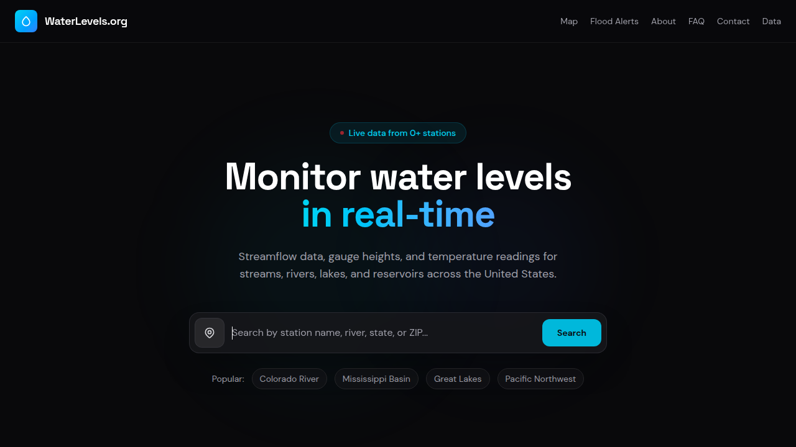
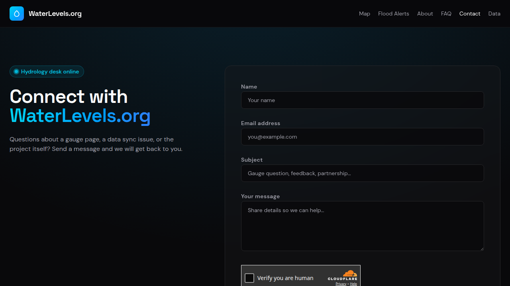
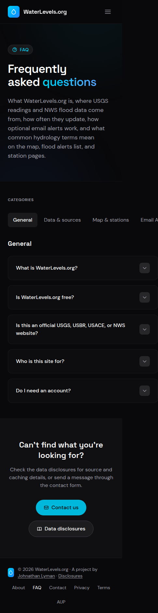
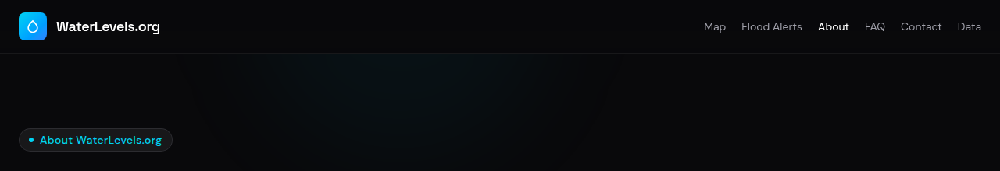
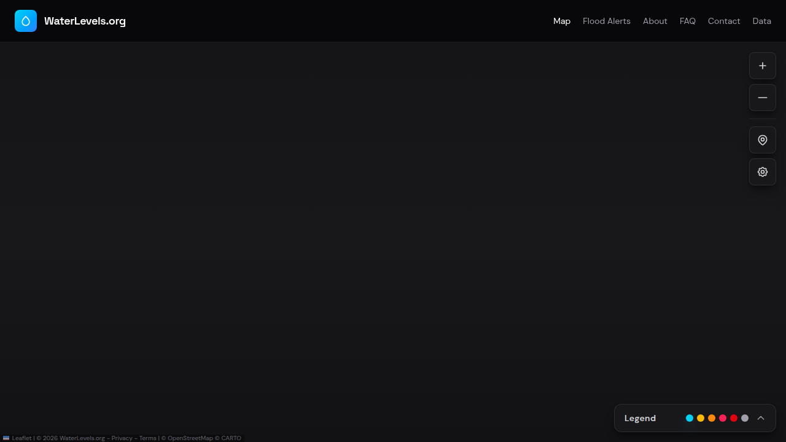
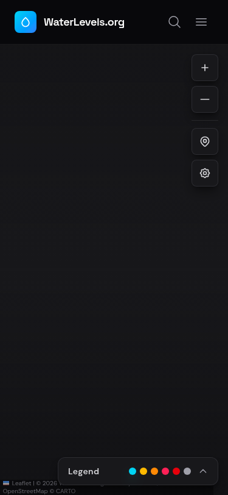

# Web Accessibility Audit

An audit of web content for WaterLevels.org, reviewed on November 24, 2026 (Pacific time). The tables below are stamped 2026-11-25 UTC, which is the generator's clock. Read the executive summary for the verdict, the priorities section for what to do first, and the findings tables for detail.

## Metadata

What was audited, with what, and under which settings.

| Field | Value |
|---|---|
| Date | 2026-11-25 |
| Scope | 79 items |
| Skills run | alt-text-headings, aria-specialist, contrast-master, forms-specialist, keyboard-navigator, link-checker, live-region-controller, modal-specialist, tables-data-specialist, testing-coach |
| Tooling | node v22.22.2, a11y-mcp-server 7.1.0 |
| Scan configuration | defaults, no config file found |
| Checks counted | 164 |

Audited:

- `.github/workflows/ci.yml`
- `DESIGN.md`
- `Gemfile`
- `Procfile.dev`
- `app/assets/stylesheets/application.tailwind.css`
- `app/assets/stylesheets/base.css`
- `app/assets/stylesheets/contact.css`
- `app/assets/stylesheets/faq.css`
- `app/assets/stylesheets/gauge/alerts.css`
- `app/assets/stylesheets/gauge/history.css`
- `app/assets/stylesheets/gauge/related.css`
- `app/assets/stylesheets/gauge/summary.css`
- `app/assets/stylesheets/home.css`
- `app/assets/stylesheets/map/canvas.css`
- `app/assets/stylesheets/map/chrome.css`
- `app/assets/stylesheets/pages.css`
- `app/assets/stylesheets/search.css`
- `app/assets/stylesheets/shared.css`
- `app/assets/stylesheets/shell.css`
- `app/assets/stylesheets/states.css`
- `app/assets/stylesheets/subscriptions.css`
- `app/components/contact/form_component.html.erb`
- `app/components/contact/form_component.rb`
- `app/components/footer/thin_component.html.erb`
- `app/components/geolocation/error_dialog_component.html.erb`
- `app/components/navigation/bar_component.html.erb`
- `app/components/states/locations_table_component.html.erb`
- `app/controllers/contacts_controller.rb`
- `app/controllers/pages_controller.rb`
- `app/controllers/subscriptions_controller.rb`
- `app/helpers/application_helper.rb`
- `app/javascript/application.js`
- `app/javascript/controllers/dialog_controller.js`
- `app/javascript/controllers/faq_controller.js`
- `app/javascript/controllers/map_controller.js`
- `app/javascript/controllers/mobile_nav_controller.js`
- `app/javascript/controllers/state_directory_controller.js`
- `app/javascript/controllers/station_search_controller.js`
- `app/javascript/controllers/subscription_timezone_controller.js`
- `app/javascript/lib/carto_basemap.js`
- `app/javascript/lib/geolocation_errors.js`
- `app/javascript/lib/map_markers.js`
- `app/javascript/map.js`
- `app/models/contact_message.rb`
- `app/models/gauge_signup_feedback.rb`
- `app/views/alerts/show.html.erb`
- `app/views/gauges/_alert_signup.html.erb`
- `app/views/home/_trend_rows.html.erb`
- `app/views/home/show.html.erb`
- `app/views/layouts/application.html.erb`
- and 29 more

## How this audit was conducted

Source review of the server-rendered Rails templates, Stimulus controllers, and CSS against WCAG 2.2 AA. No application code was changed.

Pages in scope:

- https://waterlevels.org/
- https://waterlevels.org/map
- https://waterlevels.org/alerts
- https://waterlevels.org/gauges/wa
- https://waterlevels.org/about
- https://waterlevels.org/faq
- https://waterlevels.org/contact
- https://waterlevels.org/subscriptions
- https://waterlevels.org/privacy
- https://waterlevels.org/terms
- https://waterlevels.org/disclosures
- https://waterlevels.org/aup

axe-core was not run. This pass was a code review. A headless request to the production URL receives Cloudflare's human-verification page, so a scan of that URL would not have seen the application.

Screenshots are local renders from `http://127.0.0.1:3000` on the evening of November 24, 2026 (Pacific). Local `/subscriptions` returned 404 because email alerts are disabled in this environment; the signup template was still reviewed. Map tiles did not load, so flood-marker contrast is the stylesheet calculation, not a painted marker. Two gauge-signup findings were left out because gauge detail pages were not in the page list. `LINK-004` (new-tab warning) is advisory: the criterion column says `n/a`, and it is not a WCAG 2.2 AA failure.

Keyboard behavior and screen-reader output were not run in a browser. The notes under "Needs a human" from `testing-coach` are the manual and CI checklist for a later pass.

## Screenshots

Local renders of the audited templates.

### Focus and reflow

Home and map search fields set `outline-none` and draw no replacement ring.



Contact fields keep their visible labels. The focus border on the dark fill is the control-contrast finding.



FAQ categories sit in a horizontal scroller at 375px, so later labels are clipped.



The current header item is white text against gray text, with no second cue.



### Map

The map page has no visible page heading. Tiles did not load in this capture, so markers are absent. Zoom, locate, and settings are icon buttons.



At 375px the wordmark, search button, and menu fit on one row. The 320px overflow finding was not reproduced at this width.



### Other pages

Full-page captures: [home](screenshots/home.png), [alerts](screenshots/alerts.png), [Washington directory](screenshots/gauges-wa.png), [about](screenshots/about.png), [FAQ](screenshots/faq.png), [contact](screenshots/contact.png), [privacy](screenshots/privacy.png), [terms](screenshots/terms.png), [disclosures](screenshots/disclosures.png), [acceptable use](screenshots/aup.png). Alerts and the state directory show an empty station list in this seed because every demo station is stale and "Show offline / stale" is unchecked. The empty text is in the page.

## Executive summary

Fail. Critical or serious findings must be fixed before this ships.

The headline numbers for this run.

| Measure | Value |
|---|---|
| Score | 77 out of 100 |
| Grade | C |
| Findings | 58 |
| Blocking (critical plus serious) | 30 |
| Verdict | Fail |

## Severity breakdown

Counts by severity, highest impact first.

| Severity | Count | What it means |
|---|---:|---|
| critical | 0 | Blocks a person from completing the task |
| serious | 30 | Major barrier with a difficult workaround |
| moderate | 25 | Real friction, workaround exists |
| minor | 3 | Noticeable but rarely blocking |

## Findings

58 findings, ordered by severity then by rule.

### Serious (30)

Each row names the rule, the criterion it fails, where it is, and what to change.

| Rule | WCAG | Location | Problem | Fix |
|---|---|---|---|---|
| `ARIA-BANNER-DUPLICATE` | 1.3.1 A | app/views/alerts/show.html.erb:13 | Flood alerts and state directory pages render a second header next to the site header, so assistive technology exposes two banners and the h1 is outside main. | Change header.state-hero to a div and place it inside main so there is one banner and the h1 is in the main landmark. Apply the same change at app/views/states/show.html.erb:20. |
| `ARIA-COMBOBOX-ACTIVE` | 4.1.2 A | app/javascript/controllers/map_controller.js:395 | Enter on the map combobox submits the first result while arrow keys expose a different option, and aria-activedescendant is left pointing at a removed id after the list is rebuilt. | In one Enter handler, activate the option at searchActiveIndex when it is set; otherwise submit the first match. In renderSearchResults, remove aria-activedescendant whenever the list is replaced or hidden. |
| `ARIA-COMBOBOX-OPTIONS` | 4.1.2 A | app/javascript/controllers/station_search_controller.js:203 | Search suggestions are tabbable links with role="option", and the home listbox also contains a browse link that is not an option, so the tab order and the listbox model disagree. | Render suggestions as non-focusable role="option" nodes and activate the active option from the input. Move the browse link outside #home-search-results. Use the same option markup in map_controller.js searchResultItemHtml. |
| `ARIA-EXPANDED-MISSING` | 4.1.2 A | app/components/navigation/bar_component.html.erb:26 | The map search button has no aria-expanded state and no aria-controls target, so screen readers cannot tell that it opens or closes the full-screen search. | Set aria-expanded="false" and aria-controls="map-mobile-search" on the button, and id="map-mobile-search" on the panel. Toggle aria-expanded in openMobileSearch and closeMobileSearch the way settings already does. |
| `ARIA-FOCUS-RETURN` | 2.4.3 A | app/javascript/controllers/map_controller.js:329 | Closing map search or settings hides the focused close button or field and does not return focus to the opener, so keyboard focus is lost. | Before setting hidden, if document.activeElement is inside the panel, focus the search toggle or the settings button. Do this for the in-panel close buttons and for Escape. |
| `ARIA-LIVE-HIDDEN` | 4.1.3 AA | app/views/maps/show.html.erb:129 | The stations-in-view status live region sits inside the hidden settings aside, so pan and filter updates are not announced while that panel is closed. | Move the role="status" node outside #map-settings-panel so it stays exposed. Keep updating its textContent, and do not leave the only keyboard station list inside a hidden panel. |
| `ARIA-MAP-ROLE` | 4.1.2 A | app/javascript/controllers/map_controller.js:76 | The interactive Leaflet map is forced to role="img", which treats a keyboard-focusable map as one image and hides descendant controls such as the attribution links. | Remove role="img" from the canvas. Name the map surface with role="region" and a label, and leave Leaflet attribution as real links. Do not rely on a hidden settings list as the only text alternative. |
| `CONTRAST-001` | 2.4.7 AA | app/assets/stylesheets/search.css:25 | The home and map search fields set outline-style to none and add no focus ring, so a keyboard user cannot see that the field is focused. | Remove outline-none from .home-search input. The base :focus-visible rule (2px solid var(--color-cyan-400), #00d1ec) then shows on the shell; that outline is 9.83:1 on #151518 and 10.74:1 on #09090b. |
| `CONTRAST-002` | 1.4.11 AA | app/assets/stylesheets/contact.css:20; app/assets/stylesheets/states.css:89; app/assets/stylesheets/gauge/history.css:42 | Contact, subscription, and directory fields suppress the outline, and the replacement focus border and ring stay under 3:1. | Remove outline-none, focus:ring-cyan-500/10, focus:ring-cyan-500/20, and focus:border-cyan-500/50 from contact.css, states.css, and .day-select. Keep the base 2px cyan-400 outline, which is 10.74:1 on #09090b. |
| `CONTRAST-003` | 1.4.11 AA | app/assets/stylesheets/contact.css:20; app/assets/stylesheets/search.css:8; app/assets/stylesheets/states.css:89 | Text fields and the home search shell are drawn with dark borders on dark fills, so the control boundary is below 3:1. | Use border-zinc-500 (#71717b) on .contact-form fields, .state-directory .search-field input, .day-select, and .search-shell. That border is 3.97:1 on card #0f0f11, 4.10:1 on fill #0a0a0c, and 3.78:1 on shell #151518. |
| `CONTRAST-004` | 1.4.3 AA | app/assets/stylesheets/map/canvas.css:125; app/javascript/lib/map_markers.js:4 | Moderate and major flood markers put 10px bold glyphs in near-black on dark red fills, so the category numbers miss 4.5:1. | Stop using one ink for every marker. Set the glyph to #ffffff for moderate and major (4.70:1 on #e11d48, 6.47:1 on #b91c1c). Keep #09090b on action, minor, normal, and stale fills, where it already clears 4.5:1. |
| `CONTRAST-007` | 1.4.10 AA | app/assets/stylesheets/faq.css:22 | FAQ category buttons do not wrap below the large breakpoint, so at 320px the later categories sit in a horizontal scroller. | Below 64rem, drop overflow-x-auto and shrink-0 on .faq-categories and .category-btn and use flex-wrap (the large layout already stacks them). The five labels need about 622px and the content column is 272px wide. |
| `FORM-003` | 3.3.1 A | app/controllers/contacts_controller.rb:2; app/views/pages/contact.html.erb:54 | A contact submission rejected by the Invisible Captcha timestamp check redirects with flash[:error], which the contact page never renders, so the failure is invisible. | Set on_timestamp_spam to a ContactsController method that builds ContactMessage from the posted params, sets flash.now[:alert] to "Sorry, that was too quick! Please resubmit.", and renders pages/contact. The template prints flash[:alert] only, never flash[:error]. |
| `HEAD-001` | 1.3.1 A | app/views/maps/show.html.erb:21 | The map page has no h1, and its only headings are inside hidden panels, so heading navigation finds no headings on load. | Add one h1 as the first heading in main, for example Water level map. Keep Data layers and Search stations as h2 elements, and place the h1 outside any hidden panel. |
| `IMG-001` | 1.1.1 A | app/javascript/controllers/map_controller.js:76 | The map is one image whose name omits stations and flood status; role=img hides markers, popups, and attribution, and the station list stays in a hidden panel. | Remove role=img from the Leaflet container. Give each marker role=img and an aria-label of the station name and status (the title option is only a tooltip). Keep the stations-in-view list available on load, outside the hidden settings panel, point the map at it with aria-describedby, and list every station in view rather than stopping at 40. |
| `KBD-001` | 2.4.1 A | app/views/layouts/application.html.erb:22 | The skip link targets #main, but no in-scope main is focusable. Turbo Drive focuses that element and then removes a temporary tabindex, so keyboard focus does not remain in the main content. | Add tabindex="-1" to every \<main id="main">. Turbo View#focusElement keeps an existing tabindex, focuses main, and leaves it there so the next Tab enters the main content. |
| `KBD-003` | 2.4.3 A | app/views/home/show.html.erb:104; app/components/states/locations_table_component.html.erb:121 | Region chips and directory jump links target headings that cannot take focus. Turbo scrolls to the heading and then removes a temporary tabindex, so Tab does not continue in that section. | Put tabindex="-1" on each homepage region article and each .county-head. Turbo will then leave focus on that heading, and the next Tab reaches the links inside the section. |
| `KBD-004` | 2.4.3 A | app/javascript/controllers/faq_controller.js:53 | FAQ hash links open the matching category and question but never focus the question button. Changing category hides the other sections, which can drop focus if it was inside the one that closed. | In openFromHash, focus the question button after openItem. If showCategory hides a section that contains document.activeElement, move focus to the category button for the section that stays open. |
| `KBD-006` | 2.4.11 AA | app/assets/stylesheets/search.css:63 | When home station results are open, the list is absolutely positioned over the popular-region chips and the links under them, and those links remain in the tab order. | Close the list when Tab leaves the combobox, or hide the chips from tab order while the list is open. Rendering .autocomplete in normal flow also stops it covering the links below. |
| `KBD-007` | 2.1.1 A | app/views/maps/show.html.erb:233 | Enter in map search always runs submitSearch, which goes to the first result, and also clicks the arrow-key highlight. The two handlers race, so the wrong station can open. | Handle Enter once. If searchActiveIndex is zero or greater, activate that option and return. Otherwise open the first result. Remove the extra Enter branch on the document keydown listener. |
| `KBD-008` | 2.4.3 A | app/javascript/controllers/map_controller.js:312 | Closing map settings or mobile search hides the panel that contains the focused control and does not move focus back to the button that opened it. | After hiding settings, focus the settings button. After hiding mobile search, focus the Search stations button. Do that for the close buttons and for Escape in onKeydown. |
| `KBD-009` | 2.4.11 AA | app/views/maps/show.html.erb:199 | The full-screen mobile map search covers the map, but the map container and attribution links stay tabbable, so focus can move to controls that are completely hidden. | While mobile search is open, set inert on the site header and the map surface, and remove inert when it closes. Return focus to the Search stations button. |
| `KBD-010` | 2.4.11 AA | app/assets/stylesheets/states.css:70 | The alerts and state filter card is sticky and has no max height. When it is taller than the viewport, jump links at the bottom cannot be scrolled into view while focused. | Give .state-directory .panel-card max-height: calc(100dvh - 3rem) and overflow-y: auto so the card scrolls. Tabbing to a jump link can then bring that link into view. |
| `KBD-011` | 2.4.7 AA | app/assets/stylesheets/shell.css:19 | On the map, the skip link and the site header are both z-50 and the header comes later, so the focused skip link is painted under the header bar and its focus indicator is not visible. | Raise .skip-link above z-50, or add isolate to .map-shell as .app-shell already does. Either one paints the focused skip link above the map header. |
| `LINK-002` | 2.4.4 A | app/javascript/controllers/map_controller.js:698 | Each map popup link says "View station" and points at a different gauge. The station name is a sibling, outside the link's sentence, paragraph, list item, or table cell. | Make the visible link the station name, for example \<a href="${path}">View ${name}\</a>. If the words stay "View station", put the name in the same anchor: View station\<span class="sr-only"> ${name}\</span>. |
| `LIVE-MAP-ERROR-HIDDEN` | 4.1.3 AA | app/javascript/controllers/map_controller.js:448 | A failed map refresh is written to the search status region inside the mobile search panel, which is hidden and display:none on desktop, so the error is not announced. | Announce the failure on a polite region that is not inside .map-mobile-search. Example: viewStatusTarget.textContent = "Couldn't refresh stations in view." Leave data-map-target="status" for search counts only. That node stays under hidden until search opens, and .map-mobile-search is md:hidden. |
| `LOGO-001` | 2.5.3 AA | app/components/navigation/bar_component.html.erb:3 | The header logo link's accessible name is Homepage, which replaces the visible wordmark WaterLevels.org on every public page. | Remove aria-label="Homepage" from the brand link. Keep the droplet SVG inside the aria-hidden mark, and let the visible WaterLevels.org text be the accessible name. |
| `MAP-IMG-001` | 4.1.2 A | app/javascript/controllers/map_controller.js:76 | role=img is set on the Leaflet map root, which is also a keyboard stop and the parent of the attribution links. | Put role=img and the text alternative on a non-interactive wrapper. Leave the Leaflet container without that role so its tabindex and the Leaflet, OpenStreetMap, CARTO, Privacy, and Terms links stay exposed as links. |
| `MODAL-003` | 2.4.3 A | app/javascript/controllers/station_search_controller.js:105; app/javascript/controllers/dialog_controller.js:28 | Home locate disables its button before the error dialog opens, so close restores focus to the body instead of that button. | Keep the locate button enabled until the dialog opens, or store that button and focus it from close() for Escape, Close, OK, and the backdrop. setLocateBusy(false) re-enables the button without moving focus back to it. |
| `MODAL-004` | 2.4.3 A | app/components/geolocation/error_dialog_component.html.erb:1; app/javascript/controllers/dialog_controller.js:24 | The geolocation error dialog is a div shown by clearing hidden, not a dialog opened with showModal(), and the page behind it is never inert. | Use a dialog element with no role or aria-modal, and open it with showModal() so it enters the top layer and the browser marks the rest of the page inert. On the home page this div sits inside .home-hero .inner (z-10), so the z-50 header stays clickable above it. |

### Moderate (25)

Each row names the rule, the criterion it fails, where it is, and what to change.

| Rule | WCAG | Location | Problem | Fix |
|---|---|---|---|---|
| `ARIA-FLEX-TEXT` | 1.3.1 A | app/views/home/show.html.erb:233 | Station name and details are adjacent flex items inside one link, with only a gap between them, so the link name can be spoken with no word boundary. | Put the name and meta spans in one flex child and include a real separator in the text, such as a comma inside the meta span. Apply that to popular links, home/_trend_rows.html.erb, map station-list links, and suggestion rows whose status is a sibling flex item. |
| `ARIA-HOME-REGIONS` | 1.3.1 A | app/views/home/show.html.erb:113 | The home stats, trends, and popular blocks are named regions. The stats strip is not a destination, and the other two are already reachable from their h2s. | Remove aria-labelledby from home-stats, home-trends, and home-popular and keep the h2 elements. Use a div for the stats strip so it is not a region landmark. |
| `ARIA-HONEYPOT` | 1.3.1 A | app/components/contact/form_component.html.erb:11 | The honeypot helper randomly positions the decoy field off-screen instead of using display:none, so screen readers can reach a field that silently discards the submission. | Do not use Invisible Captcha's random css_strategy. Put the honeypot in a container with the hidden attribute so it is out of the accessibility tree on every request. The same helper is at app/views/subscriptions/new.html.erb:29. |
| `ARIA-MAIN-HEADING` | 1.3.1 A | app/views/pages/about.html.erb:15 | On About, FAQ, and Data disclosures the h1 is in a section before main, so skip-to-main and the main landmark both skip the page title. | Move each page-hero section inside main, including the h1. Do not give the hero a landmark name. The same split is at faq.html.erb:21 and disclosures.html.erb:16. |
| `ARIA-REGION-OVERUSE` | 1.3.1 A | app/views/pages/terms.html.erb:20 | Terms (20), privacy (14), disclosures (8), AUP (4), and about (3) sections with aria-labelledby are region landmarks, so the landmark list repeats headings the H key already reaches. | Remove aria-labelledby from those sections and keep the h2 elements. Leave a section unlabeled unless it is a destination beyond heading navigation. |
| `ARIA-VISIBLE-LABEL` | 3.3.2 A | app/views/home/show.html.erb:62 | The home and map search fields have no visible label. The placeholder disappears while typing, and the name is only aria-label "Search stations". | Add a visible \<label for="home-search-input">Search stations\</label> and the same for #map-search-input. Remove the duplicate aria-label so the accessible name comes from the label. |
| `CONTRAST-005` | 1.4.1 A | app/assets/stylesheets/home.css:160; app/assets/stylesheets/map/canvas.css:19; app/assets/stylesheets/pages.css:108 | Some links have no underline, and their color is too close to nearby text to identify them without relying on color. | Underline these links at rest: .state-link, .leaflet-popup-content a, .leaflet-control-attribution a, .contact-hero .value a, and the gauge .featured-trend a / .section-link rules. Hover color alone is not a second cue. |
| `CONTRAST-006` | 1.4.1 A | app/assets/stylesheets/shell.css:144 | The current header and footer item is indicated only by switching zinc-400 text to white, with no underline, weight, or border. | On .nav-link[aria-current=page] and .site-footer a[aria-current=page], add a non-color cue such as underline or a 2px bottom border. White #ffffff versus zinc-400 #9f9fa9 is only 2.62:1, so lightness alone is not enough. |
| `CONTRAST-008` | 1.4.10 AA | app/assets/stylesheets/shell.css:26 | On the map, the header wordmark and two icon buttons are wider than a 320px row, so the bar forces horizontal scrolling. | Let the brand shrink: add min-w-0 on .site-header .inner and .brand, and allow .name to wrap. At 320px the map header leaves 124px for the name after padding, the mark, gaps, and two 40px buttons; the name is 135px. |
| `FORM-009` | 3.3.3 AA | app/models/contact_message.rb:13 | When the contact email fails the model format check, the associated field error is only "is invalid" and does not show an acceptable address. | Set the email format message to "Enter an email address in the format name@example.com." Keep rendering it in #contact-email-error. The email field already points aria-describedby at that id when the model has errors. |
| `FORM-011` | 4.1.2 A | app/javascript/controllers/map_controller.js:569 | Map station search can leave aria-activedescendant pointing at an option that renderSearchResults has already removed. | Remove aria-activedescendant whenever results are cleared, empty, or replaced, including the early returns in renderSearchResults and closeMobileSearch. The home search controller already does this in clearActiveDescendant. |
| `FORM-012` | 1.3.1 A | app/javascript/controllers/station_search_controller.js:181 | The home search listbox includes a Browse all stations on map link that is not a listbox option, so the popup role does not match its contents. | Render that footer link as a sibling after #home-search-results, not inside the role=listbox element. Leave only role=option nodes in the listbox. |
| `FORM-015` | 3.3.1 A | app/components/contact/form_component.html.erb:11; app/views/subscriptions/new.html.erb:29 | The contact and manage-link honeypot is hidden by a random CSS strategy that often leaves a labeled text field in the accessibility tree, and filling it returns a success notice. | Render both honeypots inside a hidden container, as app/views/gauges/_alert_signup.html.erb does, instead of Invisible Captcha's off-screen or 1px-clip CSS. A filled honeypot currently hits spam_detected and shows a success notice. |
| `HEAD-002` | 1.3.1 A | app/components/states/locations_table_component.html.erb:205 | Station cards on the flood alerts and state directory pages wrap each station h3 inside the card link. | Put the anchor inside the heading, for example h3 then a with the station name. Do not wrap the h3 in the card link. County and state h2 elements that contain their own links can stay as they are. |
| `KBD-002` | 2.4.3 A | app/javascript/application.js:2 | Public pages import Turbo Drive and never move focus to the new heading or main on turbo:load. After a navigation, focus falls back to the document instead of the page that just opened. | On turbo:load, set tabindex="-1" on the page h1 (or main) and call focus(). Skip that move when the visit already focused a hash target. Do not return focus to the link that started the visit. |
| `LAND-001` | 1.3.1 A | app/views/alerts/show.html.erb:13 and app/views/states/show.html.erb:20 | Flood alerts and state pages expose two banner landmarks because the site header and the page hero are both header elements, and neither banner has a label. | Change the hero from header.state-hero to a div, or move that hero inside main. Leave Navigation::BarComponent as the only header so the page has one banner. |
| `LINK-001` | 2.4.4 A | app/components/navigation/bar_component.html.erb:18 | Header links to the disclosures page say "Data", which does not say the destination is data disclosures. The footer names that same URL "Disclosures". | Use "Data disclosures" for the desktop link at line 18 and the mobile link at line 64. Use that same visible label for the footer "Disclosures" link so the repeated destination has one name. |
| `LINK-004` | n/a | app/components/footer/thin_component.html.erb:11 | The shared footer link "Johnathan Lyman" opens a new tab and the link never says so. The footer renders on every in-scope page except the map. | \<%= link_to "https://johnathan.org", rel: "noopener noreferrer", target: "_blank" do %>Johnathan Lyman (opens in new tab)\<% end %> |
| `LINK-004` | n/a | app/views/pages/about.html.erb:32; app/views/pages/privacy.html.erb:301; app/views/pages/terms.html.erb:349 | Author links on About, Privacy, and Terms open johnathan.org in a new tab and do not tell the user. | Add "(opens in new tab)" to the About link "Johnathan Lyman" and to the Privacy and Terms links "johnathan.org". Keep rel="noopener noreferrer" and target="_blank". |
| `LINK-004` | n/a | app/views/pages/disclosures.html.erb:32 | Twenty-three disclosures links use target="_blank" and none warn that they open a new tab. That includes agency names, the author credit, and bare hostnames. | Add visible text "(opens in new tab)" inside each target="_blank" anchor on this page (lines 32 through 208) and keep rel="noopener noreferrer". A warning icon also needs an equivalent sr-only phrase. |
| `LINK-004` | n/a | app/views/pages/faq.html.erb:127 | Fourteen FAQ links use target="_blank" without a new-tab warning, including the author credit, water.noaa.gov, and the agency API names. | Add "(opens in new tab)" to each target="_blank" anchor in faq.html.erb at lines 127, 128, 155, 160, 164, 168, 173, 177, 179, 195, 233, 235, 387, and 429. |
| `LIVE-FILTER-KEYSTROKE` | 4.1.3 AA | app/components/states/locations_table_component.html.erb:16 | The state directory and flood-alert search write a new polite result count on every keystroke, so screen readers queue a station count for each character. | Debounce the status text about 500ms after input. Update it immediately for checkbox changes. Do not write the count from connect(). Keep the empty \<div class="sr-only" data-state-directory-target="status" role="status" aria-live="polite" aria-atomic="true">\</div> and set textContent to "N stations shown" or "No stations match these filters." |
| `LIVE-FORM-FLASH-INITIAL` | 4.1.3 AA | app/views/pages/contact.html.erb:52; app/views/subscriptions/new.html.erb:16; app/components/contact/form_component.html.erb:68 | Contact and subscription success and error messages are rendered already filled in the first HTML response, so their status and alert roles are not announced after submit. | Do not ship role="status" or role="alert" already filled. Focus the flash on load with tabindex="-1" and autofocus, or copy it into an empty live region from the first paint after load. On field errors, focus the first [aria-invalid="true"] control so aria-describedby is read. Use role="status" for the success notice and role="alert" only for the error. |
| `LIVE-HOME-LOCATE-SILENT` | 4.1.3 AA | app/javascript/controllers/station_search_controller.js:97 | Choosing Use my location on the home page can take up to 20 seconds and only toggles aria-busy, so screen reader users get no waiting announcement. | Call this.announce("Finding the nearest station") at the start of locate, using the existing role="status" target. Clear it when navigation starts. Keep aria-busy on the button, but do not treat it as the status message. Errors already open the dialog and move focus. |
| `LIVE-MAP-LOCATE-SILENT` | 4.1.3 AA | app/javascript/controllers/map_controller.js:266 | Choosing Use my location on the map can take up to 10 seconds and then recenters the map without a polite announcement of the wait or the success. | On a polite region that exists on load, set textContent to "Finding your location" before getCurrentPosition and "Map centered on your location" in the success callback. Keep permission, timeout, and unsupported errors in the dialog, which already moves focus to OK. |

### Minor (3)

Each row names the rule, the criterion it fails, where it is, and what to change.

| Rule | WCAG | Location | Problem | Fix |
|---|---|---|---|---|
| `ARIA-COMPLEMENTARY-NAME` | 1.3.1 A | app/components/states/locations_table_component.html.erb:2 | The directory filter aside, the FAQ sidebar, and the map settings aside have no accessible name, so landmark navigation announces them only as complementary. | Name each aside from its visible heading with aria-labelledby: "Filters" on the directory aside, "Categories" on the FAQ aside, and the "Data layers" h2 on #map-settings-panel. Do not add a mismatched aria-label. |
| `CONTRAST-009` | 2.2.2 A | app/assets/stylesheets/home.css:29 | The live, contact, and state dots pulse indefinitely, and nothing on the page pauses that motion. | Keep the prefers-reduced-motion block. Also end animate-pulse and animate-ping after a few seconds, or add a pause control. The media query only helps people who already set the OS preference, which does not meet 2.2.2 for everyone else. |
| `LINK-001` | 2.4.4 A | app/components/footer/thin_component.html.erb:22 | The footer link "AUP" does not say it opens the Acceptable Use Policy. That page's heading and the terms link both use the full name. | Change the footer link text from "AUP" to "Acceptable Use Policy", matching app/views/pages/aup.html.erb and the terms link. |

## Remediation priorities

Fix these components first. Each one carries the same defect in several places, so one fix clears every instance.

| Component | Instances | Worst severity | Rules |
|---|---:|---|---|
| map | 2 | serious | `HEAD-001`, `IMG-001` |
| Site layout | 2 | serious | `KBD-001`, `KBD-002` |
| FAQ | 2 | serious | `KBD-004`, `LINK-004` |
| Map search | 2 | serious | `KBD-007`, `KBD-009` |
| Navigation::BarComponent | 2 | serious | `LINK-001`, `LOGO-001` |
| site header | 2 | moderate | `CONTRAST-006`, `CONTRAST-008` |
| States::LocationsTableComponent | 2 | moderate | `HEAD-002`, `LIVE-FILTER-KEYSTROKE` |
| Footer::ThinComponent | 2 | moderate | `LINK-001`, `LINK-004` |

Then the 30 remaining blocking findings, in this order:

1. `ARIA-BANNER-DUPLICATE` at app/views/alerts/show.html.erb:13. Change header.state-hero to a div and place it inside main so there is one banner and the h1 is in the main landmark. Apply the same change at app/views/states/show.html.erb:20.
2. `ARIA-COMBOBOX-ACTIVE` at app/javascript/controllers/map_controller.js:395. In one Enter handler, activate the option at searchActiveIndex when it is set; otherwise submit the first match. In renderSearchResults, remove aria-activedescendant whenever the list is replaced or hidden.
3. `ARIA-COMBOBOX-OPTIONS` at app/javascript/controllers/station_search_controller.js:203. Render suggestions as non-focusable role="option" nodes and activate the active option from the input. Move the browse link outside #home-search-results. Use the same option markup in map_controller.js searchResultItemHtml.
4. `ARIA-EXPANDED-MISSING` at app/components/navigation/bar_component.html.erb:26. Set aria-expanded="false" and aria-controls="map-mobile-search" on the button, and id="map-mobile-search" on the panel. Toggle aria-expanded in openMobileSearch and closeMobileSearch the way settings already does.
5. `ARIA-FOCUS-RETURN` at app/javascript/controllers/map_controller.js:329. Before setting hidden, if document.activeElement is inside the panel, focus the search toggle or the settings button. Do this for the in-panel close buttons and for Escape.
6. `ARIA-LIVE-HIDDEN` at app/views/maps/show.html.erb:129. Move the role="status" node outside #map-settings-panel so it stays exposed. Keep updating its textContent, and do not leave the only keyboard station list inside a hidden panel.
7. `ARIA-MAP-ROLE` at app/javascript/controllers/map_controller.js:76. Remove role="img" from the canvas. Name the map surface with role="region" and a label, and leave Leaflet attribution as real links. Do not rely on a hidden settings list as the only text alternative.
8. `CONTRAST-001` at app/assets/stylesheets/search.css:25. Remove outline-none from .home-search input. The base :focus-visible rule (2px solid var(--color-cyan-400), #00d1ec) then shows on the shell; that outline is 9.83:1 on #151518 and 10.74:1 on #09090b.
9. `CONTRAST-002` at app/assets/stylesheets/contact.css:20; app/assets/stylesheets/states.css:89; app/assets/stylesheets/gauge/history.css:42. Remove outline-none, focus:ring-cyan-500/10, focus:ring-cyan-500/20, and focus:border-cyan-500/50 from contact.css, states.css, and .day-select. Keep the base 2px cyan-400 outline, which is 10.74:1 on #09090b.
10. `CONTRAST-003` at app/assets/stylesheets/contact.css:20; app/assets/stylesheets/search.css:8; app/assets/stylesheets/states.css:89. Use border-zinc-500 (#71717b) on .contact-form fields, .state-directory .search-field input, .day-select, and .search-shell. That border is 3.97:1 on card #0f0f11, 4.10:1 on fill #0a0a0c, and 3.78:1 on shell #151518.
11. `CONTRAST-004` at app/assets/stylesheets/map/canvas.css:125; app/javascript/lib/map_markers.js:4. Stop using one ink for every marker. Set the glyph to #ffffff for moderate and major (4.70:1 on #e11d48, 6.47:1 on #b91c1c). Keep #09090b on action, minor, normal, and stale fills, where it already clears 4.5:1.
12. `CONTRAST-007` at app/assets/stylesheets/faq.css:22. Below 64rem, drop overflow-x-auto and shrink-0 on .faq-categories and .category-btn and use flex-wrap (the large layout already stacks them). The five labels need about 622px and the content column is 272px wide.
13. `FORM-003` at app/controllers/contacts_controller.rb:2; app/views/pages/contact.html.erb:54. Set on_timestamp_spam to a ContactsController method that builds ContactMessage from the posted params, sets flash.now[:alert] to "Sorry, that was too quick! Please resubmit.", and renders pages/contact. The template prints flash[:alert] only, never flash[:error].
14. `HEAD-001` at app/views/maps/show.html.erb:21. Add one h1 as the first heading in main, for example Water level map. Keep Data layers and Search stations as h2 elements, and place the h1 outside any hidden panel.
15. `IMG-001` at app/javascript/controllers/map_controller.js:76. Remove role=img from the Leaflet container. Give each marker role=img and an aria-label of the station name and status (the title option is only a tooltip). Keep the stations-in-view list available on load, outside the hidden settings panel, point the map at it with aria-describedby, and list every station in view rather than stopping at 40.
16. `KBD-001` at app/views/layouts/application.html.erb:22. Add tabindex="-1" to every \<main id="main">. Turbo View#focusElement keeps an existing tabindex, focuses main, and leaves it there so the next Tab enters the main content.
17. `KBD-003` at app/views/home/show.html.erb:104; app/components/states/locations_table_component.html.erb:121. Put tabindex="-1" on each homepage region article and each .county-head. Turbo will then leave focus on that heading, and the next Tab reaches the links inside the section.
18. `KBD-004` at app/javascript/controllers/faq_controller.js:53. In openFromHash, focus the question button after openItem. If showCategory hides a section that contains document.activeElement, move focus to the category button for the section that stays open.
19. `KBD-006` at app/assets/stylesheets/search.css:63. Close the list when Tab leaves the combobox, or hide the chips from tab order while the list is open. Rendering .autocomplete in normal flow also stops it covering the links below.
20. `KBD-007` at app/views/maps/show.html.erb:233. Handle Enter once. If searchActiveIndex is zero or greater, activate that option and return. Otherwise open the first result. Remove the extra Enter branch on the document keydown listener.
10 more are in the findings table above.

The remaining 28 moderate and minor findings can follow in normal work.

## What passed

106 checks ran and found nothing.

- About, privacy, terms, disclosures, and acceptable use do not change content after load.
- Body and secondary text: zinc-100 #f4f4f5 on #09090b is 18.10:1, and zinc-400 #9f9fa9 on #09090b is 7.59:1 and on #18181b is 6.75:1 (need 4.5:1). Gray text on white is not used.
- Button text #09090b on cyan-500 #00b6d4 is 8.19:1 and on blue-500 #3280ff is 5.37:1. Submit-gradient samples from cyan-500 to blue-500 stay at or above 5.37:1.
- CI job javascript runs yarn test:js with actions/setup-node@v7, node-version-file .nvmrc, and yarn install --frozen-lockfile.
- CI job test in .github/workflows/ci.yml runs bin/rails test on pull_request and push to main, and that command loads test/integration/accessibility_smoke_test.rb.
- Contact field errors are tied to inputs with aria-invalid and aria-describedby.
- Contact fields and both public email fields set required. Search fields are optional and omit required.
- Contact fields use label for/id, required, and aria-invalid plus aria-describedby only when the matching error element is rendered. The subscription email field has a matching label.
- Contact model errors set aria-invalid=true and aria-describedby to the matching field-error id, and the re-render keeps the posted values.
- Contact name uses autocomplete=name and email uses autocomplete=email. Signup and manage-link email fields use autocomplete=email.
- Contact name, email, subject, and message have explicit label for/id pairs. Placeholders are hints, not the only name.
- Contact, subscription, and state-directory fields that use outline-none also set a focus border and ring
- Decorative SVGs are aria-hidden, and icon-only buttons and links have accessible names
- Decorative icons, glow blobs, and legend swatches are aria-hidden. Icon-only header and map buttons have accessible names.
- Default :focus-visible outline #00d1ec is 10.74:1 on #09090b and 9.56:1 on #18181b. Buttons, links, summaries, and checkboxes do not remove it. Skip-link text #09090b on #00d1ec is 10.74:1; its white outline on #09090b is 19.90:1.
- Dialog aria-labelledby and aria-describedby ids exist in the dialog component. Template aria-controls, aria-labelledby, and aria-describedby references resolve.
- Directory checkbox and flood-stage changes write one polite station count per change.
- Directory checkbox groups expose a group name with role=group and aria-label, and each checkbox has its own label.
- Directory filters announce the visible count or an empty message in a polite live region
- Disabled locate control: after opacity 0.6, zinc-300 text on the faded button is still 4.60:1.
- Each of the 12 pages sets a unique descriptive title as page name | WaterLevels.org (2.4.2)
- Each page has one main; primary, mobile, and footer navs have distinct names
- FAQ answers are buttons inside h3 elements. aria-expanded updates, aria-controls and aria-labelledby resolve, and only one panel is open.
- FAQ answers are disclosures with aria-expanded, not live regions.
- FAQ category buttons and question disclosures are native buttons, so Enter and Space work; hidden sections leave the tab order
- FAQ questions put the button inside the h3, and geolocation dialogs use an h2
- Field errors are text-rose-400 words. Flash notice #53eafd on #081a1f is 12.36:1 and flash alert #ffa3ae on #220c13 is 9.82:1.
- Flood and station status include a text label with the dot (Nominal, Offline, or the flood category). Map legend items also name the shape. Status text colors on the card surfaces clear 4.5:1; the lowest checked is rose-400 #ff6880 on #0f0f11 at 6.88:1.
- Geolocation dialog has a visible Close button with aria-label, and its icon is aria-hidden.
- Geolocation dialog keydown handler closes on Escape.
- Geolocation dialog keydown handler wraps Tab and Shift+Tab between the Close and OK buttons.
- Geolocation dialog name comes from aria-labelledby on its h2.
- Geolocation errors open a dialog, move focus to OK, and expose the message as the dialog description.
- Home and directory status regions use .sr-only clipping, not display:none or visibility:hidden.
- Home and map search inputs have aria-label Search stations. Directory search on alerts and state pages has a label for station-search.
- Home combobox aria-expanded and aria-activedescendant are cleared when the list closes. State directory search has a visible label, and its status live region is not inside a hidden panel.
- Home search supports Arrow Up/Down, Enter, and Escape, keeps focus on the input, and clears aria-activedescendant when the list closes. Map search uses the same arrow keys while the input is focused.
- Home station search announces polite result counts from a status region present before the fetch, using textContent, after a 200ms debounce so each keystroke is not announced.
- Home station search supports Arrow Up, Arrow Down, Enter, and Escape from the combobox
- Home trend lists show a text empty message
- Home, alerts, state, about, FAQ, contact, subscriptions, privacy, terms, disclosures, and AUP each have one h1 and do not skip heading levels
- Icon buttons: zinc-400 #9f9fa9 on #09090b is 7.59:1 and on #18181b is 6.75:1; zinc-300 #d4d4d8 on #18181b is 11.99:1 (need 3:1).
- Initial focus moves to the OK button, the acknowledgment action.
- Large gradient headings on #09090b: cyan-400 10.74:1, midpoint #25bbfc 9.09:1, blue-400 7.59:1; contact accent to blue-500 ends at 5.37:1 (need 3:1).
- Layer filter changes announce a station count when the map settings panel is already open.
- Legend and county jump use native details and summary. Directory groups are unlabeled sections with h2s, not extra regions.
- Locate triggers on the home page and the map are button elements.
- Map legend swatches are aria-hidden and paired with text labels
- Map pan and zoom remain available from the Leaflet map container, and the zoom controls are native buttons
- Map settings aria-expanded updates and aria-controls points at #map-settings-panel. Zoom, locate, and close buttons are named and their icons are aria-hidden.
- Map station list is a ul of links with a text empty state
- Map station search uses that same polite count announcement once the mobile search panel is open.
- Marker cluster counts: white on cyan-500 at 55% over #18181b is #ffffff on #0b6f81, 5.83:1. Legend swatches on #18181b clear 3:1; the lowest is red-600 #e40016 at 3.64:1.
- Mobile navigation uses a button with aria-expanded, aria-controls pointing at #mobile-primary-nav, display:none when closed, focus moved into the panel, and focus returned to the toggle on Escape.
- Mobile navigation: Escape closes the panel and focus returns to the menu button; it is not a keyboard trap
- Navigation uses links. Search, locate, map zoom, settings, FAQ categories, and form submit use buttons. No anchor lacks href.
- No adjacent image and text links share a destination.
- No aria-live=assertive is used for search, filter, or map updates. role=alert is reserved for form errors.
- No bare URL fails 2.4.4. Each raw URL or path is in a sentence or paragraph that states where it goes.
- No character-key shortcut runs unless the map or a search field is focused (2.1.4)
- No click here, read more, learn more, here, or more link text.
- No complex header, colspan, or rowspan association
- No div or span controls with role=button, and no role=button on button elements.
- No img, picture, video, or audio in the in-scope templates; no content image is missing alt
- No in-scope dialog element is opened with the open attribute or HTMLDialogElement.show().
- No in-scope link points at a PDF, CSV, or other non-HTML file.
- No layout table
- No non-modal keyboard trap
- No positive tabindex on the 12 public pages
- No sortable column, so aria-sort is not required
- No table, role=table, or role=grid in the in-scope templates
- No toast, snackbar, or auto-dismiss banner exists, so none disappear before they can be read.
- On .app-shell pages, isolation keeps the focused skip link above the header
- Placeholders that set placeholder:text-zinc-400: #9f9fa9 on the search shell #151518 is 6.95:1 and on field fill #0a0a0c is 7.54:1.
- Primary, mobile, footer, and FAQ navs have distinct accessible names. Current links use aria-current=page.
- Repeated labels such as Manage email alerts, flood alerts list, Contact, About, FAQ, and NWPS API each go to one destination.
- Search suggestion lists are listboxes updated with innerHTML, not live regions, so the full list is not re-read.
- Skip link is the first focusable control and stays off-screen until focused
- Skip link targets #main, and each in-scope page has one main element.
- Skip link text is Skip to main content. Desktop and mobile primary nav are not exposed together.
- State directory and flood-alert empty results use a text message
- Station card metric labels remain in the DOM when the grid reflows
- Station cards, trend rows, popular waterway rows, search results, and the map station list are one link each and include the station or place name.
- Submit controls are native submit buttons or inputs. No password, file, or date fields are in scope.
- The dialog heading is an h2.
- The gauge signup honeypot is inside a hidden element, with a label and tabindex=-1.
- The home and map error dialogs are not nested.
- The only theme is dark (color-scheme: dark, bg-zinc-950). There is no light palette and no dark: variant to recheck.
- The signup checkbox Include in daily digest is wrapped in its label. No radio group is in these forms.
- The skip link is first, targets #main on every page, and is shown on focus (2.4.1)
- The smoke test and test/controllers/contacts_controller_test.rb assert contact errors render aria-invalid=true and aria-describedby=contact-name-error.
- The smoke test asserts FAQ categories use aria-label=FAQ categories, aria-current, and aria-expanded, and that the page has no role=tablist.
- The smoke test asserts a gauge page renders role=tablist, role=tab, and aria-controls=graph-panel.
- The smoke test asserts aria-current=page on the About link.
- The smoke test asserts href=#main, id=main, and a main element on /, /map, /about, /faq, /contact, /disclosures, /privacy, /terms, /aup, and /alerts.
- The smoke test asserts the home combobox role, aria-controls=home-search-results, a listbox, and a polite live region.
- The smoke test asserts the map combobox role, aria-controls=map-search-results, the Stations in view heading, and legend text Normal (circle) and Action (A / diamond).
- The smoke test asserts the mobile menu button has aria-controls=mobile-primary-nav and aria-expanded=false in the initial HTML, and that the panel id exists.
- The test job uses Postgres 16 and Redis 7, sets DATABASE_URL, and leaves REDIS_URL unset so RedisConfig keeps its default.
- Viewport is width=device-width, initial-scale=1 with no maximum-scale, and reviewed font sizes use rem, so 200% browser zoom is not blocked in source.
- application.html.erb has no form controls. No multi-step wizard is implemented for these forms.
- aria-describedby points at one short plain-text paragraph.
- html lang is en (3.1.1), and no in-scope passage is in another language (3.1.2)
- prefers-reduced-motion in base.css sets animation-duration and transition-duration to 0.01ms and scroll-behavior to auto.
- test/controllers/home_controller_test.rb asserts the home and map geolocation dialog ids and data-controller=dialog are present in the HTML.
- test/javascript/a11y_contrast_tokens.test.js fails if text-zinc-500 or placeholder zinc-500 or zinc-600 appear in app/assets/stylesheets, and it asserts a global :focus-visible 2px outline, a .skip-link rule, and prefers-reduced-motion.

## Needs a human

Items a skill could not decide, or could not check automatically.

- **alt-text-headings**: On about, FAQ, disclosures, flood alerts, and state pages the h1 is before #main, so the skip link moves past the page heading. 2.4.1 is still met because the repeated header is bypassed. Files: pages/about.html.erb:15, pages/faq.html.erb:21, pages/disclosures.html.erb:16, alerts/show.html.erb:21, states/show.html.erb:28.
- **alt-text-headings**: main#main has no tabindex=-1. Current HTML moves the sequential focus start to the fragment, so this was not filed as a failure.
- **alt-text-headings**: Decorative inline SVGs omit focusable=false. They are removed with aria-hidden, often on a parent, and are not tab stops in current browsers.
- **alt-text-headings**: Privacy repeats Your Rights and Controlling Your Personal Information as an h2 (privacy.html.erb:162) and an h3 (line 272). Both describe their sections, so this was not filed under 2.4.6; distinct wording would separate them in the heading list.
- **alt-text-headings**: The map page has no footer or contentinfo landmark. Attribution links are rendered inside the map widget.
- **alt-text-headings**: Cloudflare Turnstile on the contact form and the subscription page is third-party markup; its images and headings are not in these templates.
- **alt-text-headings**: ul role=list restores list semantics after Tailwind preflight sets list-style: none. It was not treated as a redundant landmark.
- **alt-text-headings**: Titles were confirmed from public_meta_tags (site WaterLevels.org, reverse) and the meta-tags gem, not from a rendered browser. Gauge detail, admin, and mailers were out of scope. No raster images were available to compare with alt text.
- **aria-specialist**: Source review only. Live-region speech, Safari flex-item name calculation, and whether aria-modal keeps virtual focus inside the div dialog without inert were not run in a browser.
- **aria-specialist**: The geolocation dialog meets the custom dialog checklist (role, aria-modal, label, description, Tab trap, Escape, focus return) but is a div, not a native dialog, and the controller never sets inert on the rest of the page.
- **aria-specialist**: FAQ category buttons update aria-current and do not use tab roles or aria-controls. That fits a button group because arrow-key tab selection is not implemented.
- **aria-specialist**: Directory and map checkbox groups use role=group with an aria-label that matches the nearby text. A fieldset and legend would name them without ARIA; the current names are not broken references.
- **aria-specialist**: Contact and subscription failures re-render a flash role=alert, and contact field errors use aria-describedby. Focus is not moved to the first invalid control. Whether the initial alert is announced on load was not runtime-tested.
- **aria-specialist**: The Turnstile wrapper aria-label is on a generic div, which browsers ignore. The injected iframe title is not in these templates.
- **aria-specialist**: Map station search and its opener are both hidden from the md breakpoint up, so desktop has no search combobox for any input method.
- **aria-specialist**: Alert and state temperature values are empty until temperature_unit_controller fills them. Those pages do not render the aria-pressed unit buttons.
- **aria-specialist**: Prose ul role=list repeats the implicit list role. Those lists use list-disc, so this is not a list-style:none repair and was not treated as a double announcement.
- **contrast-master**: Ratios use WCAG 2 relative luminance on 8-bit sRGB. Tailwind v4 OKLCH stops were chroma-mapped into gamut first. In-gamut zinc stops did not change: zinc-400 is #9f9fa9 and zinc-950 is #09090b. Alpha blends are sRGB source-over.
- **contrast-master**: zinc-400 #9f9fa9 on white #ffffff is 2.62:1, but no reviewed public surface puts gray text on white.
- **contrast-master**: zinc-500 #71717b on #09090b is 4.12:1. Public styles do not use text-zinc-500.
- **contrast-master**: Author checkbox borders would fail (zinc-700 #3f3f46 on #09090b is 1.91:1), but appearance is not none, so the painted control is the user-agent widget under color-scheme:dark. Map filters only set accent-color. Those native widgets were not measured.
- **contrast-master**: Major-flood triangle fill #b91c1c against the map canvas #18181b is 2.74:1. Dark Matter tiles replace that canvas, so contrast against live tiles was not proven.
- **contrast-master**: Site header is in normal flow (overlay is false). .county-head is sticky top-0 with no scroll-padding, so 2.4.11 Focus Not Obscured could not be proven from source.
- **contrast-master**: Disabled history toolbar text after group opacity 0.4 is 2.02:1, and locked range labels #52525c on #101013 are 2.46:1. 1.4.3 and 1.4.11 exempt inactive controls, so those are not filed.
- **contrast-master**: The map canvas is a two-dimensional view and is exempt from 1.4.10. Gauge .segmented is overflow-x-auto and the measurements table scrolls inside .scroll; that table is the two-dimensional exception. Neither is on the 12 URLs. 320px layout was not rendered.
- **contrast-master**: Hydrograph series colors are set in app/javascript/controllers/hydrograph_controller.js, outside the stylesheet scope, and were not measured. JavaScript map and chart motion was not checked for matchMedia.
- **contrast-master**: No prefers-contrast, forced-colors, or prefers-reduced-transparency rules. Those queries are not WCAG 2.2 AA requirements by themselves.
- **contrast-master**: Gauge breadcrumbs use zinc-400 for every link with no underline. They are not on the 12 URLs. The separator is aria-hidden; zinc-700 #3f3f46 on #09090b is 1.91:1.
- **forms-specialist**: Nothing moves focus to the first invalid field after contact, signup, or manage-link errors. Those are full-page responses with the error text in the document, so this was not scored as a failure of 3.3.1.
- **forms-specialist**: Posted email is discarded on the contact too-fast redirect, on station signup redirects, and when the manage-link bot check re-renders without setting @email. There is no multi-step wizard. This was not scored as 3.3.7, whose intent is multi-step processes; preserve the values while fixing the error text.
- **forms-specialist**: Browser constraint validation can block an empty or obviously malformed email before submit. The server messages above are what render when that check is bypassed or the model still rejects the value.
- **forms-specialist**: Turnstile's aria-label sits on a generic div, which browsers do not expose. The injected iframe title was not verified. Bot-check text is visible and is not tied to the widget with aria-describedby.
- **forms-specialist**: Invisible Captcha picks display:none, off-screen, or a 1px clip at random, so the honeypot is not in the accessibility tree on every render.
- **forms-specialist**: Directory filtering writes the match count into a polite live region on every keystroke, including connect. A failed home or map search response leaves the UI unchanged and shows no error. Neither was scored as 4.1.3.
- **forms-specialist**: Map search binds Enter twice: submitSearch always opens the first match, and the document keydown handler clicks the highlighted option. Which navigation wins was not executed.
- **forms-specialist**: Home and map result rows are links with role=option, so Tab can walk every result as well as the arrow keys. Not scored as a failure.
- **forms-specialist**: Searches are not wrapped in a search element. Checkbox groups use role=group and aria-label rather than fieldset and legend. Required fields have no visible required text. The required attribute is set.
- **forms-specialist**: subscription_timezone_controller.js only writes a hidden time_zone on the public signup form. Admin login and tokenized manage and unsubscribe pages were not reviewed.
- **forms-specialist**: Two gauge-signup findings (server error text and aria-invalid on gauges/_alert_signup.html.erb) were left out of this report because gauge detail pages were not in the 12-page scope.
- **keyboard-navigator**: Code review only; focus was not exercised in a browser. Turbo View#focusElement removes a temporary tabindex after focus(); whether every browser then blurs that element was not run.
- **keyboard-navigator**: Map markers are created with keyboard: false. Marker clusters still use Leaflet's default keyboard: true. A marker popup is not keyboard-reachable; the Stations in view list in Map settings (40 links) plus zoom is the keyboard path. Desktop has no Search stations control; that button is hidden from the md breakpoint up for pointer users as well.
- **keyboard-navigator**: Arrow keys set aria-activedescendant on home and map search and never call scrollIntoView. Search returns at most 8 rows. Not filed on its own because DOM focus stays on the input; the missing input outline is KBD-005. The map list can clip the highlight inside overflow-y-auto.
- **keyboard-navigator**: The geolocation dialog cycles Tab while open. That trap is a modal and was left to the modal specialist.
- **keyboard-navigator**: About, FAQ, disclosures, alerts, and state pages place the h1 before main, so Skip to main content also skips the hero. Those heroes have no interactive controls.
- **keyboard-navigator**: Cloudflare Turnstile on the contact and subscription forms injects an iframe whose keyboard behavior is not in this repository.
- **keyboard-navigator**: Whether the open map settings panel fully covers the legend depends on viewport height and was not proven. gauges/show.html.erb, admin, and mailers were not reviewed.
- **link-checker**: W3C technique G201 (updated 18 May 2026) says a new-tab warning is advisory and is not required to meet 2.4.4, 2.4.9, or 3.2.5. LINK-004 is reported because the assigned checklist requires the warning. No in-scope target=_blank link includes one.
- **link-checker**: Bare URLs and the path /gauges/wa were not failed at 2.4.4 because the same sentence or paragraph gives the purpose. 2.4.9 AAA was not scored. Locations: privacy.html.erb:17, :198, :301, :302; terms.html.erb:349, :350; faq.html.erb:128, :195, :286, :387, :429; disclosures.html.erb:72, :74, :77, :79, :145, :150, :152, :157, :162, :167, :172, :181.
- **link-checker**: RISE (disclosures.html.erb:37) and NWPS (disclosures.html.erb:208) are clear in the same sentence, so they were not failed at 2.4.4.
- **link-checker**: Map attribution links in map_controller.js:202 and carto_basemap.js:6 do not set target=_blank. Leaflet was not executed, so a library-injected new tab could not be proven.
- **link-checker**: The map template does not render Footer::ThinComponent. Header links are on all 12 pages. Manage Email Alerts renders only when AlertsConfig.enabled? is true; its text is specific when present.
- **link-checker**: Gauge CSV export and related_map_controller.js "Open station" are outside this scope. Station-card names come from data; an empty name was not proven.
- **live-region-controller**: Map station fetch and both station searches have no timeout and no loading text. Source does not prove those requests last longer than about two seconds. Geolocation timeouts do: 10 seconds on the map and 20 seconds on the home page.
- **live-region-controller**: state-directory filter() runs from connect() and writes the initial count during page load. Whether assistive technologies speak that, or drop it for the page-load announcement, cannot be proven from source.
- **live-region-controller**: Contact and subscription forms return a full document (data-turbo=false). The on-load alert finding follows the ARIA alert pattern; a screen reader was not run.
- **live-region-controller**: FAQ category buttons swap hidden sections and set aria-current, with no status region. Scored as navigation, not as a result count.
- **live-region-controller**: Hiding a focused station card can move keyboard focus. Not scored; the result count is still written to the status region.
- **live-region-controller**: app/javascript/map.js only registers the map controllers. app/javascript/lib/geolocation_errors.js only returns dialog title and body copy.
- **live-region-controller**: Flood-alert and state-directory lists are server-rendered and do not poll. Turnstile errors inside the Cloudflare iframe were not reviewed. The manage-link email field uses native required validation, which was not executed.
- **live-region-controller**: Search responses that are not OK return without a visible error or status text in station_search_controller.js and map_controller.js fetchSearchResults. Nothing on screen changes, so this was not scored as a missed announcement.
- **live-region-controller**: No toast library was assumed. Source for the scoped public pages has no toast, snackbar, or dismiss timer.
- **modal-specialist**: Mobile primary navigation in app/components/navigation/bar_component.html.erb is an in-flow disclosure. Modal focus-trap, inert, and showModal checks do not apply. Escape closes it and focus returns to the menu button.
- **modal-specialist**: Map mobile search in app/views/maps/show.html.erb covers the map and leaves the header operable, so it is an overlay sheet rather than a modal. Escape closes it. Focus moves to the search field and is not returned to the search toggle.
- **modal-specialist**: The map settings panel is an anchored disclosure with aria-expanded. Page content stays operable. Escape closes it. Opening it does not move focus.
- **modal-specialist**: The map legend is a native details disclosure. Modal checks do not apply.
- **modal-specialist**: Home and map station suggestions are combobox listboxes. On the home page, Escape hides the list and returns focus to the input.
- **modal-specialist**: FAQ answers are accordion disclosures. Modal checks do not apply.
- **modal-specialist**: Leaflet marker popups on /map are non-modal. Escape calls map.closePopup(). They are not dialog elements.
- **modal-specialist**: The county or region jump on /gauges/wa and /alerts is a details disclosure. Modal checks do not apply.
- **modal-specialist**: app/views/layouts/application.html.erb contains no dialog, popover, drawer, overlay, or aria-modal. Each in-scope page renders Navigation::BarComponent itself. Alerts, about, contact, subscriptions, privacy, terms, disclosures, and aup templates have no modal.
- **modal-specialist**: No popover attribute appears in the reviewed templates. Screen-reader announcement of the geolocation dialog was not runtime-checked. On /map the locate button stays enabled, so focus return can succeed when that button still has focus; the browser permission UI was not runtime-checked.
- **tables-data-specialist**: No table is in scope. Home, map, alerts, the Washington state directory, content pages, and subscriptions/new.html.erb contain no table element, caption, th, or aria-sort, so findings is empty.
- **tables-data-specialist**: States::LocationsTableComponent, rendered by app/views/states/show.html.erb and app/views/alerts/show.html.erb, is a card list. Each metric is a text label followed by its value in .card-metrics. That is not a column-aligned div table, so caption, scope, and aria-sort rules were not applied as failures.
- **tables-data-specialist**: Home stats and the state and alert hero counts are separate label-and-value cards. Trend and popular regions are lists. They were not treated as data tables.
- **tables-data-specialist**: Gauge measurement tables in Gauges::MeasurementsComponent and the hydrograph table view are rendered from app/views/gauges/show.html.erb only. That template was out of scope and was not audited.
- **tables-data-specialist**: Code review only. Filter announcements and the map station list, built in app/javascript/controllers/map_controller.js outside the file list, were read from source and not run in a browser.
- **testing-coach**: Automated setup. This pass did not run axe. Scan http://127.0.0.1:3000 after bin/dev (Procfile.dev starts Puma, the esbuild watcher, and the Tailwind watcher). Leave https://waterlevels.org out of headless runs; Cloudflare Turnstile blocks them. Keep the current static checks and add one browser runner. Gemfile has no Capybara, Selenium, or Cuprite. package.json has no Playwright, Cypress, Jest, or Pa11y, and yarn test:js is node --test with no DOM. Use Playwright with @axe-core/playwright. Cypress, Jest, and Storybook would be a second stack this app does not have. Pa11y standards are WCAG2A, WCAG2AA, and WCAG2AAA, with no WCAG 2.2 tag. Run axe with tags wcag2a, wcag2aa, wcag21a, wcag21aa, and wcag22aa. axe-core covers one new WCAG 2.2 criterion, 2.5.8 Target Size (rule target-size). 2.4.11 Focus Not Obscured, 2.5.7 Dragging Movements, 3.2.6 Consistent Help, 3.3.7 Redundant Entry, and 3.3.8 Accessible Authentication stay manual. A Lighthouse accessibility score of 100 is a subset of axe and is not conformance. Automation misses accurate names, tab order, focus return, live-region timing, and custom keyboard behavior.
- **testing-coach**: Automated cases. On load, scan /, /map, /alerts, /gauges/wa, one gauge URL, /about, /faq, /contact, /subscriptions when alerts are enabled (the controller returns 404 when they are off), /privacy, /terms, /disclosures, and /aup. Scan again after interaction, limited to the changed region: open the mobile menu; open one FAQ answer; type two characters in the home combobox and wait for #home-search-results; below 768px open map search and wait for #map-search-results; open #map-settings-panel; deny geolocation and wait for [role=dialog]; POST the contact form empty and scan the 422 page; on /gauges/wa clear a measurement checkbox and wait for the status text; on /alerts clear a flood-stage checkbox. Include .map-canvas so its accessible name is checked. Until role=img moves off the Leaflet root, expect nested interactive or hidden-link failures there. Seed a few Washington stations, including one in major flood (demo site 99000020). Skip the full 864k-row db:seed on every pull request. The smoke test never requests /gauges/wa or /subscriptions, and the test named keyboard-accessible only searches the HTML string. Extend that Minitest file for static strings: skip link, filter group labels, the subscription email label, and flood status text such as Major Flooding. Keep those string checks separate from any keyboard assertion. Filter checkboxes are size-4 (16px) inside a full-width label in states.css .filter-check and in the map layer labels. When axe reports target-size, measure the label row. WCAG 2.5.8 allows a target under 24 CSS pixels when the 24px circles around adjacent targets do not overlap. Map close buttons are size-8 and size-10.
- **testing-coach**: Manual keyboard checklist. Unplug the mouse. Cover /, /map, /faq, /contact, /gauges/wa, /alerts, and /subscriptions, and use the skip link on /about, /privacy, /terms, /disclosures, and /aup. Test the mobile menu and map search at 375px. At the md breakpoint (768px) .header-actions and .map-mobile-search are display:none, and .desktop-nav is shown. Keys: Tab and Shift+Tab move between controls; Enter activates a link or button; Space activates a button or toggles a checkbox; Escape closes an overlay; Arrow keys move inside a combobox; Home and End are optional in a list. The only acceptable trap is the geolocation dialog, and Escape must leave it. WCAG 2.1.1, 2.4.1, 2.4.3, 2.4.7, 2.4.11, and 1.4.11.
- **testing-coach**: Keyboard, skip link and mobile nav. First Tab on every page is Skip to main content (app/views/layouts/application.html.erb). It sits off-screen until focus (.skip-link uses translateY(-200%) and returns on :focus and :focus-visible, with a white outline). Enter moves focus to #main. Shift+Tab from the first control in main reaches the skip link again. Below 768px, the menu button name is Open main menu, aria-expanded is false, and aria-controls is mobile-primary-nav. Enter or Space opens it, focus moves to the first link, and the name becomes Close main menu with aria-expanded true. Tab through Map, Flood Alerts, About, FAQ, Contact, Data, and Manage Email Alerts when alerts are on. The panel is a disclosure, so Tab must be able to leave it. Escape closes it and returns focus to the toggle (mobile_nav_controller.js). At 768px and wider, those buttons are display:none and the desktop links in nav Primary are the tab stops, with aria-current=page on the current item. Confirm the focus ring is the global cyan 2px outline and is not fully covered by the header (2.4.11).
- **testing-coach**: Keyboard, FAQ and comboboxes. On /faq, category controls are buttons in nav FAQ categories. Enter or Space shows that section and sets aria-current=true on the active button. Arrow keys between categories are optional. Each question is a button in an h3 with aria-expanded and aria-controls. Enter or Space toggles it. Opening one closes the others. The answer is a region named by the question. Up and Down between headers are optional in the APG accordion pattern. A hash such as /faq#id opens that item and must not trap focus. Home combobox: the input name is Search stations, role=combobox, aria-expanded starts false, aria-controls=home-search-results. After two characters the listbox opens, aria-expanded becomes true, and the polite status says N results available or No matching stations. Down and Up set aria-activedescendant and aria-selected. Enter follows the active option. Enter with no active option goes to the first result or /map. Escape closes the list, clears the active descendant, and leaves focus in the input. Tab must not stick in the list. Options are links, so if Tab enters them the accessible name is the station, state, or ZIP. Use my location is a button; while it works it is disabled and aria-busy=true. Map combobox (#map-search-input, #map-search-results) follows the same APG combobox pattern. Arrow keys run from the document keydown listener only while that input is focused and the list is open, so test arrows there. The combobox and its Search stations button exist below 768px. At desktop width they are display:none; use Stations in view for the same task.
- **testing-coach**: Keyboard, map canvas, settings, and geolocation dialog. After load, the canvas name is Water gauges map. Use Search stations or the Stations in view list for keyboard access. Markers are not required tab stops (2.1.1 equivalent path: search, Stations in view, /gauges/wa, /alerts, and gauge pages). Dragging the map is not the only way to reach a station (2.5.7). Zoom in, Zoom out, Use my location, and Map settings are buttons outside the canvas and stay in tab order with a visible ring. Tab to the attribution links (Leaflet, WaterLevels.org, Privacy, Terms, OpenStreetMap, CARTO) and record whether they are announced. They currently sit inside the role=img node. Map settings: the button starts aria-expanded=false and aria-controls=map-settings-panel. Enter or Space opens the panel and sets aria-expanded=true. Tab reaches Close settings, the Measurement filters checkboxes, the Station status checkbox, and the station links. Space toggles a checkbox. Escape and Close settings hide the panel. Focus must return to Map settings. closeSettings does not do that when focus is inside the panel. The panel is a disclosure, so a focus trap is not required, and the zoom buttons may stay tabbable if the ring stays visible (2.4.11). Below 768px, Search stations opens the full-screen overlay and focuses #map-search-input. The button currently has no aria-expanded or aria-controls. Run the combobox checks, then Close search and Escape. Focus must return to Search stations. closeMobileSearch does not call focus(). While the overlay is open, map chrome is display:none; confirm Tab does not land under it. Geolocation dialog, from home and from the map, after denying permission, timing out, or with geolocation missing: role=dialog, aria-modal=true, title and body match the error (Location permission denied, Location request timed out, Location not supported, or Couldn't get your location). Focus lands on OK. Tab and Shift+Tab cycle only through Close and OK. Escape, OK, Close, and the backdrop close it and restore focus to the locate button. Also check 200% zoom and a 320px width on the map chrome, FAQ, and both forms (1.4.4, 1.4.10). prefers-reduced-motion is already in the CSS; confirm the menu and FAQ do not depend on motion.
- **testing-coach**: Keyboard, forms, state directory, and flood status. Contact (/contact): tab order is Name, Email address, Subject, Your message, the Turnstile widget when it renders, then Send message. Each control has a visible label (1.3.1, 3.3.2, 2.5.3). The placeholder is a hint. Submit empty and with email bad. The response is 422. Each invalid field has aria-invalid=true and aria-describedby pointing at contact-name-error, contact-email-error, contact-subject-error, or contact-message-error, and the error text is visible (3.3.1). The form does a full page render (data-turbo=false); confirm focus is findable on the first error (2.4.3). A Turnstile failure exposes role=alert on #contact-turnstile-error. Email hello@waterlevels.org works without solving the widget (3.3.8). The honeypot subtitle is not a tab stop. Subscriptions (/subscriptions, alerts enabled): the email field label is Email address, for=manage-link-email, autocomplete=email, required. The submit button is Email me a manage link. When TURNSTILE_SECRET is set, the widget is named Bot check and is reachable. A failed check shows a role=alert flash, Please complete the bot check and try again, and the email value remains (3.3.1, 3.3.7). Success is a role=status notice, If that address is subscribed, a manage link is on its way. The honeypot is not a tab stop. State directory (/gauges/wa): Search stations has a visible label. Groups are Measurement types (Streamflow, Gauge Height, Water Quality and Temp), Station status when any station is stale (Show offline / stale), and Flood alerts when any station is in flood (Stations with alerts). Space toggles the native checkboxes. The polite live region becomes N stations shown or No stations match these filters, once (4.1.3). Hidden cards are not in the tab order. Quick county jump is a details/summary; Enter or Space opens it; the links are real hrefs to the county headings. At 1024px and wider the details starts open. Flood-stage checkboxes are on /alerts, where the same component groups by state: Action Stage, Minor Flooding, Moderate Flooding, and Major Flooding, plus Measurement types and Quick state jump. /alerts does not render the Stations with alerts checkbox. Flood status (1.4.1, 1.4.3, 1.4.11): turn on grayscale or a color-vision simulation. Map legend text is Normal (circle), Action (A / diamond), Minor (1 / square), Moderate (2 / triangle), Major (3 / triangle), and Inactive (x). The swatches are aria-hidden. On /gauges/wa and /alerts the status words are Major Flooding, Moderate Flooding, Minor Flooding, Action Stage, Nominal, or Offline, and the dot is aria-hidden. Demo site 99000020 is major flood. The CSS token test only bans text-zinc-500 in stylesheets, so check the rendered flood red, rose, and orange on zinc-950, and the legend labels in text-zinc-400. Help (Contact in the primary nav, and hello@waterlevels.org on the contact page) should sit in the same place on all 12 pages (3.2.6).
- **testing-coach**: Screen reader guide. Minimum pair: NVDA with Chrome or Firefox, and VoiceOver with Safari. Add JAWS with Chrome for an enterprise pass, and VoiceOver on iOS for the mobile menu and the map search overlay. WebAIM Screen Reader User Survey #11 (July-August 2026) is a survey sample, not market share. Set NVDA speech near 40 percent while learning, and turn on browse-mode auto focus. NVDA key is Insert, or Caps Lock if set. Stop speech with Ctrl. Down and Up read items. H and Shift+H move by heading. D moves by landmark. F moves by form field. B moves by button. NVDA+F7 lists headings, links, and landmarks. Enter activates. Enter on a field enters forms mode; Escape leaves it. VoiceOver: Cmd+F5 toggles. VO is Control+Option. VO+Right and VO+Left move. VO+Space activates. VO+U opens the rotor (headings, landmarks, form controls, links). On iOS, swipe through a station card and a search result. The status word and the value stay separate words, and the hidden dot is not an empty stop.
- **testing-coach**: Screen reader, page skeleton and the listed components. On each of the 12 pages: the title is announced (2.4.2); the rotor shows one h1 and no skipped levels (1.3.1, 2.4.6); landmarks include a banner, a nav named Primary, main, and a content info. FAQ also has a nav named FAQ categories. The map main is the map. Skip to main content is a link before the banner, and activating it lands in main. Mobile menu button announces Open main menu, collapsed. After activation it announces Close main menu, expanded, then the links. Escape returns to that button. FAQ category button announces General, current, and the others not current. A question button announces the question and collapsed. After Enter it announces expanded, and the next item is the answer region named by the question. Home and map combobox: the input announces Search stations, combobox, collapsed. After two characters the polite live region announces N results available or No matching stations without moving focus (4.1.3). Down Arrow announces the option name and selected. The option is a link with role=option; the name is the station, state, or ZIP, heard once. Escape announces collapsed. Use my location announces busy while the lookup runs. Map canvas: the virtual cursor hears the image name and the instruction to use search or Stations in view. A marker list inside the image is not expected. If Tab lands inside the map, note whether the attribution links are silent. That is a 4.1.2 failure while role=img stays on the Leaflet root. Stations in view announces N stations in view or No stations in view when the list updates (4.1.3). Map settings button announces Map settings, collapsed, then expanded, then the group Measurement filters and each checkbox name and checked state. Close settings is a button. Mobile search heading is Search stations, the close button is Close search, then the same combobox announcements. After Escape, the virtual cursor is back on the control that opened the overlay. Geolocation dialog: on open, the title and the body are read (aria-labelledby and aria-describedby) and focus is on OK. Titles from geolocation_errors.js are Location permission denied, Location request timed out, Location not supported, and Couldn't get your location. The permission-denied body says to allow location or search by name. Tab stays inside. Escape returns to Use my location. Contact: each field announces its label once; a placeholder, if heard, is a hint after the label. Required is announced. After an invalid submit the field announces invalid and the error text. Turnstile, if present, announces Bot check. The fallback link is Email hello@waterlevels.org. A base error uses role=alert and interrupts. Subscription: Email address, required, edit; button Email me a manage link. The alert flash interrupts. The success notice is polite and must be heard after the redirect (4.1.3). State directory (/gauges/wa): Search stations; groups Measurement types, Station status when any station is stale, and Flood alerts when any station is in flood. Each checkbox announces its label and checked state. After a change the live region says N stations shown or No stations match these filters, once. County headings are h2. On /alerts the same list announces Flood stages (Action Stage, Minor Flooding, Moderate Flooding, Major Flooding) and Measurement types, and the jump links are states. A flood card status line, on both pages, is the words Major Flooding, Minor Flooding, Moderate Flooding, Action Stage, Nominal, or Offline (1.4.1). Eyes-closed journeys: from / search a station and open it; from /map open settings and follow a station in view; from /alerts filter to a flood stage and open a card; from /gauges/wa filter by measurement type and open a card; submit /contact with a bad email and hear the error; request a manage link on /subscriptions.
- **testing-coach**: CI. Add a fifth job, a11y, to .github/workflows/ci.yml. Keep scan_ruby, lint, javascript, and test. Same triggers: pull_request, and push to main. Runner ubuntu-latest. Steps follow the file already there: actions/checkout@v7, ruby/setup-ruby@v1 with bundler-cache, actions/setup-node@v7 with node-version-file .nvmrc (Node 24) and cache yarn, then yarn install --frozen-lockfile. Copy the postgres:16 and redis:7 service blocks from the test job, because gauge, state, and map pages read the database. Run bin/rails db:test:prepare and a small fixture load in RAILS_ENV=test so Turnstile is not required. Leave REDIS_URL unset, matching the comment on the test job. Install Chromium only (npx playwright install --with-deps chromium). Start Puma the way Procfile.dev does, bin/rails server -p 3000 -b 127.0.0.1, wait until http://127.0.0.1:3000 responds, then npx playwright test --project=a11y. There is no npm start script. Do not scan the public URL. Fail the job on any violation for those tags. Upload the Playwright report. Leave yarn test:js on the javascript job and the smoke test inside bin/rails test. Those already fail CI for banned contrast tokens and for missing skip links, landmarks, combobox attributes, FAQ button semantics, the mobile nav attributes, aria-current, contact error association, and gauge tabs. A green axe run is not a conformance claim. 2.4.11, 2.5.7, 3.2.6, 3.3.7, and 3.3.8 stay on the manual list. 2.5.8 is the WCAG 2.2 check the wcag22aa tag actually runs.

## Next steps

1. Fix the 30 blocking findings above, starting with any repeated component.
2. Re-run this audit and check the delta section for regressions.
3. Wire the scan into continuous integration so the next regression is caught before review.

Automated checks find a minority of accessibility barriers. A passing score is a floor, not a guarantee.

## Findings data

The merged findings, embedded so the next run can compute a delta without parsing this document.

```json a11y-findings
{
  "skills": [
    "alt-text-headings",
    "aria-specialist",
    "contrast-master",
    "forms-specialist",
    "keyboard-navigator",
    "link-checker",
    "live-region-controller",
    "modal-specialist",
    "tables-data-specialist",
    "testing-coach"
  ],
  "scope": [
    ".github/workflows/ci.yml",
    "DESIGN.md",
    "Gemfile",
    "Procfile.dev",
    "app/assets/stylesheets/application.tailwind.css",
    "app/assets/stylesheets/base.css",
    "app/assets/stylesheets/contact.css",
    "app/assets/stylesheets/faq.css",
    "app/assets/stylesheets/gauge/alerts.css",
    "app/assets/stylesheets/gauge/history.css",
    "app/assets/stylesheets/gauge/related.css",
    "app/assets/stylesheets/gauge/summary.css",
    "app/assets/stylesheets/home.css",
    "app/assets/stylesheets/map/canvas.css",
    "app/assets/stylesheets/map/chrome.css",
    "app/assets/stylesheets/pages.css",
    "app/assets/stylesheets/search.css",
    "app/assets/stylesheets/shared.css",
    "app/assets/stylesheets/shell.css",
    "app/assets/stylesheets/states.css",
    "app/assets/stylesheets/subscriptions.css",
    "app/components/contact/form_component.html.erb",
    "app/components/contact/form_component.rb",
    "app/components/footer/thin_component.html.erb",
    "app/components/geolocation/error_dialog_component.html.erb",
    "app/components/navigation/bar_component.html.erb",
    "app/components/states/locations_table_component.html.erb",
    "app/controllers/contacts_controller.rb",
    "app/controllers/pages_controller.rb",
    "app/controllers/subscriptions_controller.rb",
    "app/helpers/application_helper.rb",
    "app/javascript/application.js",
    "app/javascript/controllers/dialog_controller.js",
    "app/javascript/controllers/faq_controller.js",
    "app/javascript/controllers/map_controller.js",
    "app/javascript/controllers/mobile_nav_controller.js",
    "app/javascript/controllers/state_directory_controller.js",
    "app/javascript/controllers/station_search_controller.js",
    "app/javascript/controllers/subscription_timezone_controller.js",
    "app/javascript/lib/carto_basemap.js",
    "app/javascript/lib/geolocation_errors.js",
    "app/javascript/lib/map_markers.js",
    "app/javascript/map.js",
    "app/models/contact_message.rb",
    "app/models/gauge_signup_feedback.rb",
    "app/views/alerts/show.html.erb",
    "app/views/gauges/_alert_signup.html.erb",
    "app/views/home/_trend_rows.html.erb",
    "app/views/home/show.html.erb",
    "app/views/layouts/application.html.erb",
    "app/views/maps/show.html.erb",
    "app/views/pages/_faq_item.html.erb",
    "app/views/pages/about.html.erb",
    "app/views/pages/aup.html.erb",
    "app/views/pages/contact.html.erb",
    "app/views/pages/disclosures.html.erb",
    "app/views/pages/faq.html.erb",
    "app/views/pages/privacy.html.erb",
    "app/views/pages/terms.html.erb",
    "app/views/states/show.html.erb",
    "app/views/subscriptions/new.html.erb",
    "doc/accessibility.md",
    "https://waterlevels.org/",
    "https://waterlevels.org/about",
    "https://waterlevels.org/alerts",
    "https://waterlevels.org/aup",
    "https://waterlevels.org/contact",
    "https://waterlevels.org/disclosures",
    "https://waterlevels.org/faq",
    "https://waterlevels.org/gauges/wa",
    "https://waterlevels.org/map",
    "https://waterlevels.org/privacy",
    "https://waterlevels.org/subscriptions",
    "https://waterlevels.org/terms",
    "package.json",
    "test/controllers/contacts_controller_test.rb",
    "test/controllers/home_controller_test.rb",
    "test/integration/accessibility_smoke_test.rb",
    "test/javascript/a11y_contrast_tokens.test.js"
  ],
  "findings": [
    {
      "rule": "ARIA-BANNER-DUPLICATE",
      "wcag": "1.3.1 A",
      "severity": "serious",
      "location": "app/views/alerts/show.html.erb:13",
      "component": "Alerts and state heroes",
      "summary": "Flood alerts and state directory pages render a second header next to the site header, so assistive technology exposes two banners and the h1 is outside main.",
      "fix": "Change header.state-hero to a div and place it inside main so there is one banner and the h1 is in the main landmark. Apply the same change at app/views/states/show.html.erb:20.",
      "evidence": "<header class=\"site-header\">…</header><header class=\"state-hero\"><h1>…</h1></header><main id=\"main\">",
      "foundBy": [
        "aria-specialist"
      ]
    },
    {
      "rule": "ARIA-COMBOBOX-ACTIVE",
      "wcag": "4.1.2 A",
      "severity": "serious",
      "location": "app/javascript/controllers/map_controller.js:395",
      "component": "Map station search",
      "summary": "Enter on the map combobox submits the first result while arrow keys expose a different option, and aria-activedescendant is left pointing at a removed id after the list is rebuilt.",
      "fix": "In one Enter handler, activate the option at searchActiveIndex when it is set; otherwise submit the first match. In renderSearchResults, remove aria-activedescendant whenever the list is replaced or hidden.",
      "evidence": "keydown.enter->map#submitSearch always uses searchResults[0]; renderSearchResults does not clear aria-activedescendant.",
      "foundBy": [
        "aria-specialist"
      ]
    },
    {
      "rule": "ARIA-COMBOBOX-OPTIONS",
      "wcag": "4.1.2 A",
      "severity": "serious",
      "location": "app/javascript/controllers/station_search_controller.js:203",
      "component": "Station search combobox",
      "summary": "Search suggestions are tabbable links with role=\"option\", and the home listbox also contains a browse link that is not an option, so the tab order and the listbox model disagree.",
      "fix": "Render suggestions as non-focusable role=\"option\" nodes and activate the active option from the input. Move the browse link outside #home-search-results. Use the same option markup in map_controller.js searchResultItemHtml.",
      "evidence": "<a href=\"…\" class=\"item\" role=\"option\"> inside role=\"listbox\", plus a footer <a> with no option role.",
      "foundBy": [
        "aria-specialist"
      ]
    },
    {
      "rule": "ARIA-EXPANDED-MISSING",
      "wcag": "4.1.2 A",
      "severity": "serious",
      "location": "app/components/navigation/bar_component.html.erb:26",
      "component": "Map search toggle",
      "summary": "The map search button has no aria-expanded state and no aria-controls target, so screen readers cannot tell that it opens or closes the full-screen search.",
      "fix": "Set aria-expanded=\"false\" and aria-controls=\"map-mobile-search\" on the button, and id=\"map-mobile-search\" on the panel. Toggle aria-expanded in openMobileSearch and closeMobileSearch the way settings already does.",
      "evidence": "<button type=\"button\" data-action=\"map#openMobileSearch\" aria-label=\"Search stations\">",
      "foundBy": [
        "aria-specialist",
        "testing-coach"
      ],
      "alsoReportedAs": [
        "MAP-STATE-001"
      ]
    },
    {
      "rule": "ARIA-FOCUS-RETURN",
      "wcag": "2.4.3 A",
      "severity": "serious",
      "location": "app/javascript/controllers/map_controller.js:329",
      "component": "Map search and settings",
      "summary": "Closing map search or settings hides the focused close button or field and does not return focus to the opener, so keyboard focus is lost.",
      "fix": "Before setting hidden, if document.activeElement is inside the panel, focus the search toggle or the settings button. Do this for the in-panel close buttons and for Escape.",
      "evidence": "closeMobileSearch() sets mobileSearchTarget.hidden = true and does not call focus() on the opener.",
      "foundBy": [
        "aria-specialist",
        "forms-specialist",
        "testing-coach"
      ],
      "alsoReportedAs": [
        "FORM-014",
        "MAP-FOCUS-001"
      ]
    },
    {
      "rule": "ARIA-LIVE-HIDDEN",
      "wcag": "4.1.3 AA",
      "severity": "serious",
      "location": "app/views/maps/show.html.erb:129",
      "component": "Map settings",
      "summary": "The stations-in-view status live region sits inside the hidden settings aside, so pan and filter updates are not announced while that panel is closed.",
      "fix": "Move the role=\"status\" node outside #map-settings-panel so it stays exposed. Keep updating its textContent, and do not leave the only keyboard station list inside a hidden panel.",
      "evidence": "<aside id=\"map-settings-panel\" hidden>…<div data-map-target=\"stationListStatus\" role=\"status\" aria-live=\"polite\">",
      "foundBy": [
        "aria-specialist",
        "live-region-controller"
      ],
      "alsoReportedAs": [
        "LIVE-MAP-VIEW-HIDDEN"
      ]
    },
    {
      "rule": "ARIA-MAP-ROLE",
      "wcag": "4.1.2 A",
      "severity": "serious",
      "location": "app/javascript/controllers/map_controller.js:76",
      "component": "Map canvas",
      "summary": "The interactive Leaflet map is forced to role=\"img\", which treats a keyboard-focusable map as one image and hides descendant controls such as the attribution links.",
      "fix": "Remove role=\"img\" from the canvas. Name the map surface with role=\"region\" and a label, and leave Leaflet attribution as real links. Do not rely on a hidden settings list as the only text alternative.",
      "evidence": "this.canvasTarget.setAttribute(\"role\", \"img\")",
      "foundBy": [
        "aria-specialist"
      ]
    },
    {
      "rule": "CONTRAST-001",
      "wcag": "2.4.7 AA",
      "severity": "serious",
      "location": "app/assets/stylesheets/search.css:25",
      "component": "home-search",
      "summary": "The home and map search fields set outline-style to none and add no focus ring, so a keyboard user cannot see that the field is focused.",
      "fix": "Remove outline-none from .home-search input. The base :focus-visible rule (2px solid var(--color-cyan-400), #00d1ec) then shows on the shell; that outline is 9.83:1 on #151518 and 10.74:1 on #09090b.",
      "evidence": ".home-search input compiles to outline-style:none with no :focus border or box-shadow. It is used on / and on the map search. The unlayered rule overrides @layer base :focus-visible.",
      "foundBy": [
        "contrast-master",
        "keyboard-navigator"
      ],
      "alsoReportedAs": [
        "KBD-005"
      ]
    },
    {
      "rule": "CONTRAST-002",
      "wcag": "1.4.11 AA",
      "severity": "serious",
      "location": "app/assets/stylesheets/contact.css:20; app/assets/stylesheets/states.css:89; app/assets/stylesheets/gauge/history.css:42",
      "component": "contact-form",
      "summary": "Contact, subscription, and directory fields suppress the outline, and the replacement focus border and ring stay under 3:1.",
      "fix": "Remove outline-none, focus:ring-cyan-500/10, focus:ring-cyan-500/20, and focus:border-cyan-500/50 from contact.css, states.css, and .day-select. Keep the base 2px cyan-400 outline, which is 10.74:1 on #09090b.",
      "evidence": "Focus border #056070 on field fill #0a0a0c is 2.74:1 and on card #0f0f11 is 2.66:1. Ring cyan-500 at 10% on #0f0f11 is 1.14:1; at 20% it is 1.36:1. .day-select focus border is 2.76:1 on #151518. Need 3:1.",
      "foundBy": [
        "contrast-master"
      ]
    },
    {
      "rule": "CONTRAST-003",
      "wcag": "1.4.11 AA",
      "severity": "serious",
      "location": "app/assets/stylesheets/contact.css:20; app/assets/stylesheets/search.css:8; app/assets/stylesheets/states.css:89",
      "component": "text fields",
      "summary": "Text fields and the home search shell are drawn with dark borders on dark fills, so the control boundary is below 3:1.",
      "fix": "Use border-zinc-500 (#71717b) on .contact-form fields, .state-directory .search-field input, .day-select, and .search-shell. That border is 3.97:1 on card #0f0f11, 4.10:1 on fill #0a0a0c, and 3.78:1 on shell #151518.",
      "evidence": "Border #27272a on fill #0a0a0c is 1.33:1; fill #0a0a0c on card #0f0f11 is 1.03:1. Search shell border #2a2a2f on #09090b is 1.39:1 and shell fill #151518 on #09090b is 1.09:1. Need 3:1.",
      "foundBy": [
        "contrast-master"
      ]
    },
    {
      "rule": "CONTRAST-004",
      "wcag": "1.4.3 AA",
      "severity": "serious",
      "location": "app/assets/stylesheets/map/canvas.css:125; app/javascript/lib/map_markers.js:4",
      "component": "map marker",
      "summary": "Moderate and major flood markers put 10px bold glyphs in near-black on dark red fills, so the category numbers miss 4.5:1.",
      "fix": "Stop using one ink for every marker. Set the glyph to #ffffff for moderate and major (4.70:1 on #e11d48, 6.47:1 on #b91c1c). Keep #09090b on action, minor, normal, and stale fills, where it already clears 4.5:1.",
      "evidence": "canvas.css sets color:#09090b at 0.625rem/700. Moderate fill #e11d48 is 4.24:1. Major fill #b91c1c is 3.07:1. Fills are the inline --marker-fill values in app/javascript/lib/map_markers.js:4-5. Need 4.5:1.",
      "foundBy": [
        "contrast-master"
      ]
    },
    {
      "rule": "CONTRAST-007",
      "wcag": "1.4.10 AA",
      "severity": "serious",
      "location": "app/assets/stylesheets/faq.css:22",
      "component": "faq-categories",
      "summary": "FAQ category buttons do not wrap below the large breakpoint, so at 320px the later categories sit in a horizontal scroller.",
      "fix": "Below 64rem, drop overflow-x-auto and shrink-0 on .faq-categories and .category-btn and use flex-wrap (the large layout already stacks them). The five labels need about 622px and the content column is 272px wide.",
      "evidence": "Space Grotesk 600 at 16px plus px-4: General 91px, Data & sources 148px, Map & stations 148px, Email Alerts 122px, Glossary 99px, plus gaps about 622px. .faq-categories is overflow-x-auto and buttons are shrink-0 until 64rem.",
      "foundBy": [
        "contrast-master"
      ]
    },
    {
      "rule": "FORM-003",
      "wcag": "3.3.1 A",
      "severity": "serious",
      "location": "app/controllers/contacts_controller.rb:2; app/views/pages/contact.html.erb:54",
      "summary": "A contact submission rejected by the Invisible Captcha timestamp check redirects with flash[:error], which the contact page never renders, so the failure is invisible.",
      "fix": "Set on_timestamp_spam to a ContactsController method that builds ContactMessage from the posted params, sets flash.now[:alert] to \"Sorry, that was too quick! Please resubmit.\", and renders pages/contact. The template prints flash[:alert] only, never flash[:error].",
      "foundBy": [
        "forms-specialist"
      ]
    },
    {
      "rule": "HEAD-001",
      "wcag": "1.3.1 A",
      "severity": "serious",
      "location": "app/views/maps/show.html.erb:21",
      "summary": "The map page has no h1, and its only headings are inside hidden panels, so heading navigation finds no headings on load.",
      "fix": "Add one h1 as the first heading in main, for example Water level map. Keep Data layers and Search stations as h2 elements, and place the h1 outside any hidden panel.",
      "evidence": "No h1. First headings are h2 Data layers (line 71, aside hidden) and h2 Search stations (line 206, .map-mobile-search hidden).",
      "component": "map",
      "foundBy": [
        "alt-text-headings",
        "aria-specialist"
      ],
      "alsoReportedAs": [
        "ARIA-PAGE-HEADING"
      ]
    },
    {
      "rule": "IMG-001",
      "wcag": "1.1.1 A",
      "severity": "serious",
      "location": "app/javascript/controllers/map_controller.js:76",
      "summary": "The map is one image whose name omits stations and flood status; role=img hides markers, popups, and attribution, and the station list stays in a hidden panel.",
      "fix": "Remove role=img from the Leaflet container. Give each marker role=img and an aria-label of the station name and status (the title option is only a tooltip). Keep the stations-in-view list available on load, outside the hidden settings panel, point the map at it with aria-describedby, and list every station in view rather than stopping at 40.",
      "evidence": "setAttribute role=img; aria-label Water gauges map. Use Search stations or the Stations in view list. aside#map-settings-panel is hidden. Markers use title and keyboard:false. The Search stations control is in .header-actions, hidden from the md breakpoint up.",
      "component": "map",
      "foundBy": [
        "alt-text-headings"
      ]
    },
    {
      "rule": "KBD-001",
      "wcag": "2.4.1 A",
      "severity": "serious",
      "confidence": "medium",
      "location": "app/views/layouts/application.html.erb:22",
      "summary": "The skip link targets #main, but no in-scope main is focusable. Turbo Drive focuses that element and then removes a temporary tabindex, so keyboard focus does not remain in the main content.",
      "fix": "Add tabindex=\"-1\" to every <main id=\"main\">. Turbo View#focusElement keeps an existing tabindex, focuses main, and leaves it there so the next Tab enters the main content.",
      "evidence": "<a class=\"skip-link\" href=\"#main\">; each <main id=\"main\"> has no tabindex. focusElement sets tabindex=\"-1\", calls focus(), then removeAttribute.",
      "component": "Site layout",
      "foundBy": [
        "keyboard-navigator"
      ]
    },
    {
      "rule": "KBD-003",
      "wcag": "2.4.3 A",
      "severity": "serious",
      "confidence": "medium",
      "location": "app/views/home/show.html.erb:104; app/components/states/locations_table_component.html.erb:121",
      "summary": "Region chips and directory jump links target headings that cannot take focus. Turbo scrolls to the heading and then removes a temporary tabindex, so Tab does not continue in that section.",
      "fix": "Put tabindex=\"-1\" on each homepage region article and each .county-head. Turbo will then leave focus on that heading, and the next Tab reaches the links inside the section.",
      "evidence": "href=\"#region\" and href=\"#group\" point at elements that have an id and no tabindex.",
      "component": "In-page jumps",
      "foundBy": [
        "keyboard-navigator"
      ]
    },
    {
      "rule": "KBD-004",
      "wcag": "2.4.3 A",
      "severity": "serious",
      "confidence": "medium",
      "location": "app/javascript/controllers/faq_controller.js:53",
      "summary": "FAQ hash links open the matching category and question but never focus the question button. Changing category hides the other sections, which can drop focus if it was inside the one that closed.",
      "fix": "In openFromHash, focus the question button after openItem. If showCategory hides a section that contains document.activeElement, move focus to the category button for the section that stays open.",
      "evidence": "openFromHash calls showCategory, openItem, and scrollIntoView, and never focus().",
      "component": "FAQ",
      "foundBy": [
        "keyboard-navigator"
      ]
    },
    {
      "rule": "KBD-006",
      "wcag": "2.4.11 AA",
      "severity": "serious",
      "location": "app/assets/stylesheets/search.css:63",
      "summary": "When home station results are open, the list is absolutely positioned over the popular-region chips and the links under them, and those links remain in the tab order.",
      "fix": "Close the list when Tab leaves the combobox, or hide the chips from tab order while the list is open. Rendering .autocomplete in normal flow also stops it covering the links below.",
      "evidence": ".autocomplete is absolute top-full; .popular-chips follows .search-stack and stays focusable.",
      "component": "Station search",
      "foundBy": [
        "keyboard-navigator"
      ]
    },
    {
      "rule": "KBD-007",
      "wcag": "2.1.1 A",
      "severity": "serious",
      "location": "app/views/maps/show.html.erb:233",
      "summary": "Enter in map search always runs submitSearch, which goes to the first result, and also clicks the arrow-key highlight. The two handlers race, so the wrong station can open.",
      "fix": "Handle Enter once. If searchActiveIndex is zero or greater, activate that option and return. Otherwise open the first result. Remove the extra Enter branch on the document keydown listener.",
      "evidence": "keydown.enter->map#submitSearch awaits a fetch while onKeydown Enter clicks items[searchActiveIndex].",
      "component": "Map search",
      "foundBy": [
        "keyboard-navigator"
      ]
    },
    {
      "rule": "KBD-008",
      "wcag": "2.4.3 A",
      "severity": "serious",
      "location": "app/javascript/controllers/map_controller.js:312",
      "summary": "Closing map settings or mobile search hides the panel that contains the focused control and does not move focus back to the button that opened it.",
      "fix": "After hiding settings, focus the settings button. After hiding mobile search, focus the Search stations button. Do that for the close buttons and for Escape in onKeydown.",
      "evidence": "closeSettings and closeMobileSearch set hidden and never call focus(); Escape calls both.",
      "component": "Map overlays",
      "foundBy": [
        "keyboard-navigator"
      ]
    },
    {
      "rule": "KBD-009",
      "wcag": "2.4.11 AA",
      "severity": "serious",
      "location": "app/views/maps/show.html.erb:199",
      "summary": "The full-screen mobile map search covers the map, but the map container and attribution links stay tabbable, so focus can move to controls that are completely hidden.",
      "fix": "While mobile search is open, set inert on the site header and the map surface, and remove inert when it closes. Return focus to the Search stations button.",
      "evidence": ".map-mobile-search is absolute inset-0; data-search-open hides .map-chrome only, not the map canvas or attribution links.",
      "component": "Map search",
      "foundBy": [
        "keyboard-navigator"
      ]
    },
    {
      "rule": "KBD-010",
      "wcag": "2.4.11 AA",
      "severity": "serious",
      "confidence": "medium",
      "location": "app/assets/stylesheets/states.css:70",
      "summary": "The alerts and state filter card is sticky and has no max height. When it is taller than the viewport, jump links at the bottom cannot be scrolled into view while focused.",
      "fix": "Give .state-directory .panel-card max-height: calc(100dvh - 3rem) and overflow-y: auto so the card scrolls. Tabbing to a jump link can then bring that link into view.",
      "evidence": ".panel-card is sticky top-6 with no max-height or overflow; jump links sit at the bottom of that card.",
      "component": "State directory",
      "foundBy": [
        "keyboard-navigator"
      ]
    },
    {
      "rule": "KBD-011",
      "wcag": "2.4.7 AA",
      "severity": "serious",
      "location": "app/assets/stylesheets/shell.css:19",
      "summary": "On the map, the skip link and the site header are both z-50 and the header comes later, so the focused skip link is painted under the header bar and its focus indicator is not visible.",
      "fix": "Raise .skip-link above z-50, or add isolate to .map-shell as .app-shell already does. Either one paints the focused skip link above the map header.",
      "evidence": ".skip-link and .site-header are z-50; .map-shell is relative without isolate; .app-shell is isolate.",
      "component": "Map skip link",
      "foundBy": [
        "keyboard-navigator"
      ]
    },
    {
      "rule": "LINK-002",
      "wcag": "2.4.4 A",
      "severity": "serious",
      "location": "app/javascript/controllers/map_controller.js:698",
      "summary": "Each map popup link says \"View station\" and points at a different gauge. The station name is a sibling, outside the link's sentence, paragraph, list item, or table cell.",
      "fix": "Make the visible link the station name, for example <a href=\"${path}\">View ${name}</a>. If the words stay \"View station\", put the name in the same anchor: View station<span class=\"sr-only\"> ${name}</span>.",
      "evidence": "<div class=\"popup-title\">${name}</div>...<a href=\"${station.path}\">View station</a>",
      "component": "Map marker popup",
      "foundBy": [
        "link-checker"
      ]
    },
    {
      "rule": "LIVE-MAP-ERROR-HIDDEN",
      "wcag": "4.1.3 AA",
      "severity": "serious",
      "location": "app/javascript/controllers/map_controller.js:448",
      "summary": "A failed map refresh is written to the search status region inside the mobile search panel, which is hidden and display:none on desktop, so the error is not announced.",
      "fix": "Announce the failure on a polite region that is not inside .map-mobile-search. Example: viewStatusTarget.textContent = \"Couldn't refresh stations in view.\" Leave data-map-target=\"status\" for search counts only. That node stays under hidden until search opens, and .map-mobile-search is md:hidden.",
      "evidence": "this.statusTarget.textContent = \"Couldn't refresh stations in view.\" Parent is .map-mobile-search[hidden] with Tailwind md:hidden (display:none from 768px).",
      "foundBy": [
        "live-region-controller"
      ]
    },
    {
      "rule": "LOGO-001",
      "wcag": "2.5.3 AA",
      "severity": "serious",
      "location": "app/components/navigation/bar_component.html.erb:3",
      "summary": "The header logo link's accessible name is Homepage, which replaces the visible wordmark WaterLevels.org on every public page.",
      "fix": "Remove aria-label=\"Homepage\" from the brand link. Keep the droplet SVG inside the aria-hidden mark, and let the visible WaterLevels.org text be the accessible name.",
      "evidence": "<a href=\"/\" aria-label=\"Homepage\" class=\"brand\"> with <span class=\"name\">WaterLevels.org</span> and the SVG in span.mark[aria-hidden].",
      "component": "Navigation::BarComponent",
      "foundBy": [
        "alt-text-headings",
        "aria-specialist",
        "link-checker"
      ],
      "alsoReportedAs": [
        "ARIA-LABEL-IN-NAME",
        "LINK-008"
      ]
    },
    {
      "rule": "MAP-IMG-001",
      "wcag": "4.1.2 A",
      "severity": "serious",
      "confidence": "medium",
      "location": "app/javascript/controllers/map_controller.js:76",
      "summary": "role=img is set on the Leaflet map root, which is also a keyboard stop and the parent of the attribution links.",
      "fix": "Put role=img and the text alternative on a non-interactive wrapper. Leave the Leaflet container without that role so its tabindex and the Leaflet, OpenStreetMap, CARTO, Privacy, and Terms links stay exposed as links.",
      "evidence": "connect() calls L.map(this.canvasTarget), then setAttribute(\"role\",\"img\"). attributionPrefix() and CARTO_ATTRIBUTION inject links into that same node. Leaflet 1.9 defaults keyboard to true, which sets tabindex=0 on the container.",
      "component": "map canvas",
      "foundBy": [
        "testing-coach"
      ]
    },
    {
      "rule": "MODAL-003",
      "wcag": "2.4.3 A",
      "severity": "serious",
      "location": "app/javascript/controllers/station_search_controller.js:105; app/javascript/controllers/dialog_controller.js:28",
      "summary": "Home locate disables its button before the error dialog opens, so close restores focus to the body instead of that button.",
      "fix": "Keep the locate button enabled until the dialog opens, or store that button and focus it from close() for Escape, Close, OK, and the backdrop. setLocateBusy(false) re-enables the button without moving focus back to it.",
      "evidence": "setLocateBusy(true) sets locateButton.disabled before getCurrentPosition. show() then stores document.activeElement, which is no longer the button.",
      "component": "Home locate dialog",
      "foundBy": [
        "modal-specialist"
      ]
    },
    {
      "rule": "MODAL-004",
      "wcag": "2.4.3 A",
      "severity": "serious",
      "location": "app/components/geolocation/error_dialog_component.html.erb:1; app/javascript/controllers/dialog_controller.js:24",
      "summary": "The geolocation error dialog is a div shown by clearing hidden, not a dialog opened with showModal(), and the page behind it is never inert.",
      "fix": "Use a dialog element with no role or aria-modal, and open it with showModal() so it enters the top layer and the browser marks the rest of the page inert. On the home page this div sits inside .home-hero .inner (z-10), so the z-50 header stays clickable above it.",
      "evidence": "<div class=\"app-dialog\" role=\"dialog\" aria-modal=\"true\" hidden> is shown with element.hidden = false. body.dialog-open only sets overflow:hidden. No inert.",
      "component": "Geolocation error dialog",
      "foundBy": [
        "modal-specialist"
      ]
    },
    {
      "rule": "ARIA-FLEX-TEXT",
      "wcag": "1.3.1 A",
      "severity": "moderate",
      "confidence": "medium",
      "location": "app/views/home/show.html.erb:233",
      "component": "Station link rows",
      "summary": "Station name and details are adjacent flex items inside one link, with only a gap between them, so the link name can be spoken with no word boundary.",
      "fix": "Put the name and meta spans in one flex child and include a real separator in the text, such as a comma inside the meta span. Apply that to popular links, home/_trend_rows.html.erb, map station-list links, and suggestion rows whose status is a sibling flex item.",
      "evidence": "<a class=\"flex flex-col\"><span class=\"name\">…</span><span class=\"meta\">01037000 · WA</span></a>",
      "foundBy": [
        "aria-specialist"
      ]
    },
    {
      "rule": "ARIA-HOME-REGIONS",
      "wcag": "1.3.1 A",
      "severity": "moderate",
      "location": "app/views/home/show.html.erb:113",
      "component": "Home sections",
      "summary": "The home stats, trends, and popular blocks are named regions. The stats strip is not a destination, and the other two are already reachable from their h2s.",
      "fix": "Remove aria-labelledby from home-stats, home-trends, and home-popular and keep the h2 elements. Use a div for the stats strip so it is not a region landmark.",
      "evidence": "<section class=\"home-stats\" aria-labelledby=\"home-stats-heading\">",
      "foundBy": [
        "aria-specialist"
      ]
    },
    {
      "rule": "ARIA-HONEYPOT",
      "wcag": "1.3.1 A",
      "severity": "moderate",
      "location": "app/components/contact/form_component.html.erb:11",
      "component": "Contact and subscription forms",
      "summary": "The honeypot helper randomly positions the decoy field off-screen instead of using display:none, so screen readers can reach a field that silently discards the submission.",
      "fix": "Do not use Invisible Captcha's random css_strategy. Put the honeypot in a container with the hidden attribute so it is out of the accessibility tree on every request. The same helper is at app/views/subscriptions/new.html.erb:29.",
      "evidence": "css_strategy samples display:none, top:-9999px, or a 1px clip. The field label is \"If you are a human, ignore this field\".",
      "foundBy": [
        "aria-specialist"
      ]
    },
    {
      "rule": "ARIA-MAIN-HEADING",
      "wcag": "1.3.1 A",
      "severity": "moderate",
      "confidence": "medium",
      "location": "app/views/pages/about.html.erb:15",
      "component": "Page heroes",
      "summary": "On About, FAQ, and Data disclosures the h1 is in a section before main, so skip-to-main and the main landmark both skip the page title.",
      "fix": "Move each page-hero section inside main, including the h1. Do not give the hero a landmark name. The same split is at faq.html.erb:21 and disclosures.html.erb:16.",
      "evidence": "<section class=\"page-hero\"><h1>…</h1></section><main id=\"main\">",
      "foundBy": [
        "aria-specialist"
      ]
    },
    {
      "rule": "ARIA-REGION-OVERUSE",
      "wcag": "1.3.1 A",
      "severity": "moderate",
      "location": "app/views/pages/terms.html.erb:20",
      "component": "Labeled prose sections",
      "summary": "Terms (20), privacy (14), disclosures (8), AUP (4), and about (3) sections with aria-labelledby are region landmarks, so the landmark list repeats headings the H key already reaches.",
      "fix": "Remove aria-labelledby from those sections and keep the h2 elements. Leave a section unlabeled unless it is a destination beyond heading navigation.",
      "evidence": "<section aria-labelledby=\"about-services-heading\"><h2 id=\"about-services-heading\">About Our Services</h2>",
      "foundBy": [
        "aria-specialist"
      ]
    },
    {
      "rule": "ARIA-VISIBLE-LABEL",
      "wcag": "3.3.2 A",
      "severity": "moderate",
      "location": "app/views/home/show.html.erb:62",
      "component": "Station search field",
      "summary": "The home and map search fields have no visible label. The placeholder disappears while typing, and the name is only aria-label \"Search stations\".",
      "fix": "Add a visible <label for=\"home-search-input\">Search stations</label> and the same for #map-search-input. Remove the duplicate aria-label so the accessible name comes from the label.",
      "evidence": "<input type=\"search\" id=\"home-search-input\" role=\"combobox\" aria-label=\"Search stations\" placeholder=\"Search by station name…\">",
      "foundBy": [
        "aria-specialist"
      ]
    },
    {
      "rule": "CONTRAST-005",
      "wcag": "1.4.1 A",
      "severity": "moderate",
      "location": "app/assets/stylesheets/home.css:160; app/assets/stylesheets/map/canvas.css:19; app/assets/stylesheets/pages.css:108",
      "component": "text links",
      "summary": "Some links have no underline, and their color is too close to nearby text to identify them without relying on color.",
      "fix": "Underline these links at rest: .state-link, .leaflet-popup-content a, .leaflet-control-attribution a, .contact-hero .value a, and the gauge .featured-trend a / .section-link rules. Hover color alone is not a second cue.",
      "evidence": "cyan-400 #00d1ec versus zinc-400 #9f9fa9 is 1.42:1 (need 3:1 when a link is not underlined). Attribution links are color:inherit, so the difference is 1:1, and Leaflet keeps text-decoration:none until hover. The mailto link is #d4d4d8 with no underline.",
      "foundBy": [
        "contrast-master"
      ]
    },
    {
      "rule": "CONTRAST-006",
      "wcag": "1.4.1 A",
      "severity": "moderate",
      "location": "app/assets/stylesheets/shell.css:144",
      "component": "site header",
      "summary": "The current header and footer item is indicated only by switching zinc-400 text to white, with no underline, weight, or border.",
      "fix": "On .nav-link[aria-current=page] and .site-footer a[aria-current=page], add a non-color cue such as underline or a 2px bottom border. White #ffffff versus zinc-400 #9f9fa9 is only 2.62:1, so lightness alone is not enough.",
      "evidence": ".nav-link is text-zinc-400 #9f9fa9 and no-underline. [aria-current=page] sets only text-white #ffffff. Contrast between those text colors is 2.62:1. The same rule styles the footer current item.",
      "foundBy": [
        "contrast-master"
      ]
    },
    {
      "rule": "CONTRAST-008",
      "wcag": "1.4.10 AA",
      "severity": "moderate",
      "location": "app/assets/stylesheets/shell.css:26",
      "component": "site header",
      "summary": "On the map, the header wordmark and two icon buttons are wider than a 320px row, so the bar forces horizontal scrolling.",
      "fix": "Let the brand shrink: add min-w-0 on .site-header .inner and .brand, and allow .name to wrap. At 320px the map header leaves 124px for the name after padding, the mark, gaps, and two 40px buttons; the name is 135px.",
      "evidence": "Space Grotesk 600, 18px, letter-spacing -0.025em: WaterLevels.org is 135px. Flex items use min-width:auto, and .inner does not wrap. Other pages have one icon button and about 168px free, so they fit.",
      "foundBy": [
        "contrast-master"
      ]
    },
    {
      "rule": "FORM-009",
      "wcag": "3.3.3 AA",
      "severity": "moderate",
      "location": "app/models/contact_message.rb:13",
      "summary": "When the contact email fails the model format check, the associated field error is only \"is invalid\" and does not show an acceptable address.",
      "fix": "Set the email format message to \"Enter an email address in the format name@example.com.\" Keep rendering it in #contact-email-error. The email field already points aria-describedby at that id when the model has errors.",
      "foundBy": [
        "forms-specialist"
      ]
    },
    {
      "rule": "FORM-011",
      "wcag": "4.1.2 A",
      "severity": "moderate",
      "location": "app/javascript/controllers/map_controller.js:569",
      "summary": "Map station search can leave aria-activedescendant pointing at an option that renderSearchResults has already removed.",
      "fix": "Remove aria-activedescendant whenever results are cleared, empty, or replaced, including the early returns in renderSearchResults and closeMobileSearch. The home search controller already does this in clearActiveDescendant.",
      "foundBy": [
        "forms-specialist"
      ]
    },
    {
      "rule": "FORM-012",
      "wcag": "1.3.1 A",
      "severity": "moderate",
      "location": "app/javascript/controllers/station_search_controller.js:181",
      "summary": "The home search listbox includes a Browse all stations on map link that is not a listbox option, so the popup role does not match its contents.",
      "fix": "Render that footer link as a sibling after #home-search-results, not inside the role=listbox element. Leave only role=option nodes in the listbox.",
      "foundBy": [
        "forms-specialist"
      ]
    },
    {
      "rule": "FORM-015",
      "wcag": "3.3.1 A",
      "severity": "moderate",
      "confidence": "medium",
      "location": "app/components/contact/form_component.html.erb:11; app/views/subscriptions/new.html.erb:29",
      "summary": "The contact and manage-link honeypot is hidden by a random CSS strategy that often leaves a labeled text field in the accessibility tree, and filling it returns a success notice.",
      "fix": "Render both honeypots inside a hidden container, as app/views/gauges/_alert_signup.html.erb does, instead of Invisible Captcha's off-screen or 1px-clip CSS. A filled honeypot currently hits spam_detected and shows a success notice.",
      "foundBy": [
        "forms-specialist"
      ]
    },
    {
      "rule": "HEAD-002",
      "wcag": "1.3.1 A",
      "severity": "moderate",
      "confidence": "medium",
      "location": "app/components/states/locations_table_component.html.erb:205",
      "summary": "Station cards on the flood alerts and state directory pages wrap each station h3 inside the card link.",
      "fix": "Put the anchor inside the heading, for example h3 then a with the station name. Do not wrap the h3 in the card link. County and state h2 elements that contain their own links can stay as they are.",
      "evidence": "link_to path, class: station-card do ... h3 name, so the heading is a child of the anchor.",
      "component": "States::LocationsTableComponent",
      "foundBy": [
        "alt-text-headings"
      ]
    },
    {
      "rule": "KBD-002",
      "wcag": "2.4.3 A",
      "severity": "moderate",
      "location": "app/javascript/application.js:2",
      "summary": "Public pages import Turbo Drive and never move focus to the new heading or main on turbo:load. After a navigation, focus falls back to the document instead of the page that just opened.",
      "fix": "On turbo:load, set tabindex=\"-1\" on the page h1 (or main) and call focus(). Skip that move when the visit already focused a hash target. Do not return focus to the link that started the visit.",
      "evidence": "import \"@hotwired/turbo-rails\" with no turbo:load focus handler and no [autofocus] on these pages.",
      "component": "Site layout",
      "foundBy": [
        "keyboard-navigator"
      ]
    },
    {
      "rule": "LAND-001",
      "wcag": "1.3.1 A",
      "severity": "moderate",
      "location": "app/views/alerts/show.html.erb:13 and app/views/states/show.html.erb:20",
      "summary": "Flood alerts and state pages expose two banner landmarks because the site header and the page hero are both header elements, and neither banner has a label.",
      "fix": "Change the hero from header.state-hero to a div, or move that hero inside main. Leave Navigation::BarComponent as the only header so the page has one banner.",
      "evidence": "<header class=\"site-header\"> in the nav component plus <header class=\"state-hero\"> before main on alerts and state directory pages.",
      "component": "state-hero",
      "foundBy": [
        "alt-text-headings"
      ]
    },
    {
      "rule": "LINK-001",
      "wcag": "2.4.4 A",
      "severity": "moderate",
      "confidence": "medium",
      "location": "app/components/navigation/bar_component.html.erb:18",
      "summary": "Header links to the disclosures page say \"Data\", which does not say the destination is data disclosures. The footer names that same URL \"Disclosures\".",
      "fix": "Use \"Data disclosures\" for the desktop link at line 18 and the mobile link at line 64. Use that same visible label for the footer \"Disclosures\" link so the repeated destination has one name.",
      "evidence": "<%= link_to \"Data\", disclosures_path, class: \"nav-link\" %>",
      "component": "Navigation::BarComponent",
      "foundBy": [
        "link-checker"
      ]
    },
    {
      "rule": "LINK-004",
      "wcag": "n/a",
      "severity": "moderate",
      "location": "app/components/footer/thin_component.html.erb:11",
      "summary": "The shared footer link \"Johnathan Lyman\" opens a new tab and the link never says so. The footer renders on every in-scope page except the map.",
      "fix": "<%= link_to \"https://johnathan.org\", rel: \"noopener noreferrer\", target: \"_blank\" do %>Johnathan Lyman (opens in new tab)<% end %>",
      "evidence": "link_to \"Johnathan Lyman\", \"https://johnathan.org\", rel: \"noopener noreferrer\", target: \"_blank\"",
      "component": "Footer::ThinComponent",
      "foundBy": [
        "link-checker"
      ]
    },
    {
      "rule": "LINK-004",
      "wcag": "n/a",
      "severity": "moderate",
      "location": "app/views/pages/about.html.erb:32; app/views/pages/privacy.html.erb:301; app/views/pages/terms.html.erb:349",
      "summary": "Author links on About, Privacy, and Terms open johnathan.org in a new tab and do not tell the user.",
      "fix": "Add \"(opens in new tab)\" to the About link \"Johnathan Lyman\" and to the Privacy and Terms links \"johnathan.org\". Keep rel=\"noopener noreferrer\" and target=\"_blank\".",
      "evidence": "<a href=\"https://johnathan.org\" rel=\"noopener noreferrer\" target=\"_blank\">johnathan.org</a>",
      "component": "Author credit",
      "foundBy": [
        "link-checker"
      ]
    },
    {
      "rule": "LINK-004",
      "wcag": "n/a",
      "severity": "moderate",
      "location": "app/views/pages/disclosures.html.erb:32",
      "summary": "Twenty-three disclosures links use target=\"_blank\" and none warn that they open a new tab. That includes agency names, the author credit, and bare hostnames.",
      "fix": "Add visible text \"(opens in new tab)\" inside each target=\"_blank\" anchor on this page (lines 32 through 208) and keep rel=\"noopener noreferrer\". A warning icon also needs an equivalent sr-only phrase.",
      "evidence": "<a href=\"https://api.waterdata.usgs.gov/\" rel=\"noopener noreferrer\" target=\"_blank\">USGS Water Data APIs</a>",
      "component": "Data disclosures",
      "foundBy": [
        "link-checker"
      ]
    },
    {
      "rule": "LINK-004",
      "wcag": "n/a",
      "severity": "moderate",
      "location": "app/views/pages/faq.html.erb:127",
      "summary": "Fourteen FAQ links use target=\"_blank\" without a new-tab warning, including the author credit, water.noaa.gov, and the agency API names.",
      "fix": "Add \"(opens in new tab)\" to each target=\"_blank\" anchor in faq.html.erb at lines 127, 128, 155, 160, 164, 168, 173, 177, 179, 195, 233, 235, 387, and 429.",
      "evidence": "<a href=\"https://water.noaa.gov/\" rel=\"noopener noreferrer\" target=\"_blank\">water.noaa.gov</a>",
      "component": "FAQ",
      "foundBy": [
        "link-checker"
      ]
    },
    {
      "rule": "LIVE-FILTER-KEYSTROKE",
      "wcag": "4.1.3 AA",
      "severity": "moderate",
      "confidence": "medium",
      "location": "app/components/states/locations_table_component.html.erb:16",
      "component": "States::LocationsTableComponent",
      "summary": "The state directory and flood-alert search write a new polite result count on every keystroke, so screen readers queue a station count for each character.",
      "fix": "Debounce the status text about 500ms after input. Update it immediately for checkbox changes. Do not write the count from connect(). Keep the empty <div class=\"sr-only\" data-state-directory-target=\"status\" role=\"status\" aria-live=\"polite\" aria-atomic=\"true\"></div> and set textContent to \"N stations shown\" or \"No stations match these filters.\"",
      "evidence": "data-action=\"input->state-directory#filter\" and filter() assigns statusTarget.textContent with no timer. connect() calls filter().",
      "foundBy": [
        "live-region-controller"
      ]
    },
    {
      "rule": "LIVE-FORM-FLASH-INITIAL",
      "wcag": "4.1.3 AA",
      "severity": "moderate",
      "confidence": "medium",
      "location": "app/views/pages/contact.html.erb:52; app/views/subscriptions/new.html.erb:16; app/components/contact/form_component.html.erb:68",
      "component": "Flash messages",
      "summary": "Contact and subscription success and error messages are rendered already filled in the first HTML response, so their status and alert roles are not announced after submit.",
      "fix": "Do not ship role=\"status\" or role=\"alert\" already filled. Focus the flash on load with tabindex=\"-1\" and autofocus, or copy it into an empty live region from the first paint after load. On field errors, focus the first [aria-invalid=\"true\"] control so aria-describedby is read. Use role=\"status\" for the success notice and role=\"alert\" only for the error.",
      "evidence": "Flashes use role=status and role=alert only inside <% if flash %>. #contact-turnstile-error is role=alert in that same response. Forms set data-turbo=false. No autofocus.",
      "foundBy": [
        "live-region-controller"
      ]
    },
    {
      "rule": "LIVE-HOME-LOCATE-SILENT",
      "wcag": "4.1.3 AA",
      "severity": "moderate",
      "location": "app/javascript/controllers/station_search_controller.js:97",
      "summary": "Choosing Use my location on the home page can take up to 20 seconds and only toggles aria-busy, so screen reader users get no waiting announcement.",
      "fix": "Call this.announce(\"Finding the nearest station\") at the start of locate, using the existing role=\"status\" target. Clear it when navigation starts. Keep aria-busy on the button, but do not treat it as the status message. Errors already open the dialog and move focus.",
      "evidence": "setLocateBusy only sets disabled and aria-busy. getCurrentPosition timeout is 20000. The status target is not updated.",
      "foundBy": [
        "live-region-controller"
      ]
    },
    {
      "rule": "LIVE-MAP-LOCATE-SILENT",
      "wcag": "4.1.3 AA",
      "severity": "moderate",
      "location": "app/javascript/controllers/map_controller.js:266",
      "summary": "Choosing Use my location on the map can take up to 10 seconds and then recenters the map without a polite announcement of the wait or the success.",
      "fix": "On a polite region that exists on load, set textContent to \"Finding your location\" before getCurrentPosition and \"Map centered on your location\" in the success callback. Keep permission, timeout, and unsupported errors in the dialog, which already moves focus to OK.",
      "evidence": "navigator.geolocation.getCurrentPosition(..., { enableHighAccuracy: true, timeout: 10000 }) sets the view and adds a marker with no status text and no aria-busy.",
      "foundBy": [
        "live-region-controller"
      ]
    },
    {
      "rule": "ARIA-COMPLEMENTARY-NAME",
      "wcag": "1.3.1 A",
      "severity": "minor",
      "confidence": "medium",
      "location": "app/components/states/locations_table_component.html.erb:2",
      "component": "Filter and settings asides",
      "summary": "The directory filter aside, the FAQ sidebar, and the map settings aside have no accessible name, so landmark navigation announces them only as complementary.",
      "fix": "Name each aside from its visible heading with aria-labelledby: \"Filters\" on the directory aside, \"Categories\" on the FAQ aside, and the \"Data layers\" h2 on #map-settings-panel. Do not add a mismatched aria-label.",
      "evidence": "<aside class=\"filter-panel\"> and <aside class=\"faq-sidebar\"> and <aside id=\"map-settings-panel\" hidden>",
      "foundBy": [
        "aria-specialist"
      ]
    },
    {
      "rule": "CONTRAST-009",
      "wcag": "2.2.2 A",
      "severity": "minor",
      "location": "app/assets/stylesheets/home.css:29",
      "component": "status dots",
      "summary": "The live, contact, and state dots pulse indefinitely, and nothing on the page pauses that motion.",
      "fix": "Keep the prefers-reduced-motion block. Also end animate-pulse and animate-ping after a few seconds, or add a pause control. The media query only helps people who already set the OS preference, which does not meet 2.2.2 for everyone else.",
      "evidence": "home.css .live-pill .dot, pages.css .contact-hero .pulse .ring, and states.css .state-hero .dot use animate-pulse or animate-ping. gauge/related.css:112 also loops nearby-watch-pulse for 2.4s infinite. base.css only shortens motion inside prefers-reduced-motion.",
      "foundBy": [
        "contrast-master"
      ]
    },
    {
      "rule": "LINK-001",
      "wcag": "2.4.4 A",
      "severity": "minor",
      "confidence": "medium",
      "location": "app/components/footer/thin_component.html.erb:22",
      "summary": "The footer link \"AUP\" does not say it opens the Acceptable Use Policy. That page's heading and the terms link both use the full name.",
      "fix": "Change the footer link text from \"AUP\" to \"Acceptable Use Policy\", matching app/views/pages/aup.html.erb and the terms link.",
      "evidence": "<%= link_to \"AUP\", aup_path, **footer_link_attrs(aup_path) %>",
      "component": "Footer::ThinComponent",
      "foundBy": [
        "link-checker"
      ]
    }
  ],
  "passed": [
    "About, privacy, terms, disclosures, and acceptable use do not change content after load.",
    "Body and secondary text: zinc-100 #f4f4f5 on #09090b is 18.10:1, and zinc-400 #9f9fa9 on #09090b is 7.59:1 and on #18181b is 6.75:1 (need 4.5:1). Gray text on white is not used.",
    "Button text #09090b on cyan-500 #00b6d4 is 8.19:1 and on blue-500 #3280ff is 5.37:1. Submit-gradient samples from cyan-500 to blue-500 stay at or above 5.37:1.",
    "CI job javascript runs yarn test:js with actions/setup-node@v7, node-version-file .nvmrc, and yarn install --frozen-lockfile.",
    "CI job test in .github/workflows/ci.yml runs bin/rails test on pull_request and push to main, and that command loads test/integration/accessibility_smoke_test.rb.",
    "Contact field errors are tied to inputs with aria-invalid and aria-describedby.",
    "Contact fields and both public email fields set required. Search fields are optional and omit required.",
    "Contact fields use label for/id, required, and aria-invalid plus aria-describedby only when the matching error element is rendered. The subscription email field has a matching label.",
    "Contact model errors set aria-invalid=true and aria-describedby to the matching field-error id, and the re-render keeps the posted values.",
    "Contact name uses autocomplete=name and email uses autocomplete=email. Signup and manage-link email fields use autocomplete=email.",
    "Contact name, email, subject, and message have explicit label for/id pairs. Placeholders are hints, not the only name.",
    "Contact, subscription, and state-directory fields that use outline-none also set a focus border and ring",
    "Decorative SVGs are aria-hidden, and icon-only buttons and links have accessible names",
    "Decorative icons, glow blobs, and legend swatches are aria-hidden. Icon-only header and map buttons have accessible names.",
    "Default :focus-visible outline #00d1ec is 10.74:1 on #09090b and 9.56:1 on #18181b. Buttons, links, summaries, and checkboxes do not remove it. Skip-link text #09090b on #00d1ec is 10.74:1; its white outline on #09090b is 19.90:1.",
    "Dialog aria-labelledby and aria-describedby ids exist in the dialog component. Template aria-controls, aria-labelledby, and aria-describedby references resolve.",
    "Directory checkbox and flood-stage changes write one polite station count per change.",
    "Directory checkbox groups expose a group name with role=group and aria-label, and each checkbox has its own label.",
    "Directory filters announce the visible count or an empty message in a polite live region",
    "Disabled locate control: after opacity 0.6, zinc-300 text on the faded button is still 4.60:1.",
    "Each of the 12 pages sets a unique descriptive title as page name | WaterLevels.org (2.4.2)",
    "Each page has one main; primary, mobile, and footer navs have distinct names",
    "FAQ answers are buttons inside h3 elements. aria-expanded updates, aria-controls and aria-labelledby resolve, and only one panel is open.",
    "FAQ answers are disclosures with aria-expanded, not live regions.",
    "FAQ category buttons and question disclosures are native buttons, so Enter and Space work; hidden sections leave the tab order",
    "FAQ questions put the button inside the h3, and geolocation dialogs use an h2",
    "Field errors are text-rose-400 words. Flash notice #53eafd on #081a1f is 12.36:1 and flash alert #ffa3ae on #220c13 is 9.82:1.",
    "Flood and station status include a text label with the dot (Nominal, Offline, or the flood category). Map legend items also name the shape. Status text colors on the card surfaces clear 4.5:1; the lowest checked is rose-400 #ff6880 on #0f0f11 at 6.88:1.",
    "Geolocation dialog has a visible Close button with aria-label, and its icon is aria-hidden.",
    "Geolocation dialog keydown handler closes on Escape.",
    "Geolocation dialog keydown handler wraps Tab and Shift+Tab between the Close and OK buttons.",
    "Geolocation dialog name comes from aria-labelledby on its h2.",
    "Geolocation errors open a dialog, move focus to OK, and expose the message as the dialog description.",
    "Home and directory status regions use .sr-only clipping, not display:none or visibility:hidden.",
    "Home and map search inputs have aria-label Search stations. Directory search on alerts and state pages has a label for station-search.",
    "Home combobox aria-expanded and aria-activedescendant are cleared when the list closes. State directory search has a visible label, and its status live region is not inside a hidden panel.",
    "Home search supports Arrow Up/Down, Enter, and Escape, keeps focus on the input, and clears aria-activedescendant when the list closes. Map search uses the same arrow keys while the input is focused.",
    "Home station search announces polite result counts from a status region present before the fetch, using textContent, after a 200ms debounce so each keystroke is not announced.",
    "Home station search supports Arrow Up, Arrow Down, Enter, and Escape from the combobox",
    "Home trend lists show a text empty message",
    "Home, alerts, state, about, FAQ, contact, subscriptions, privacy, terms, disclosures, and AUP each have one h1 and do not skip heading levels",
    "Icon buttons: zinc-400 #9f9fa9 on #09090b is 7.59:1 and on #18181b is 6.75:1; zinc-300 #d4d4d8 on #18181b is 11.99:1 (need 3:1).",
    "Initial focus moves to the OK button, the acknowledgment action.",
    "Large gradient headings on #09090b: cyan-400 10.74:1, midpoint #25bbfc 9.09:1, blue-400 7.59:1; contact accent to blue-500 ends at 5.37:1 (need 3:1).",
    "Layer filter changes announce a station count when the map settings panel is already open.",
    "Legend and county jump use native details and summary. Directory groups are unlabeled sections with h2s, not extra regions.",
    "Locate triggers on the home page and the map are button elements.",
    "Map legend swatches are aria-hidden and paired with text labels",
    "Map pan and zoom remain available from the Leaflet map container, and the zoom controls are native buttons",
    "Map settings aria-expanded updates and aria-controls points at #map-settings-panel. Zoom, locate, and close buttons are named and their icons are aria-hidden.",
    "Map station list is a ul of links with a text empty state",
    "Map station search uses that same polite count announcement once the mobile search panel is open.",
    "Marker cluster counts: white on cyan-500 at 55% over #18181b is #ffffff on #0b6f81, 5.83:1. Legend swatches on #18181b clear 3:1; the lowest is red-600 #e40016 at 3.64:1.",
    "Mobile navigation uses a button with aria-expanded, aria-controls pointing at #mobile-primary-nav, display:none when closed, focus moved into the panel, and focus returned to the toggle on Escape.",
    "Mobile navigation: Escape closes the panel and focus returns to the menu button; it is not a keyboard trap",
    "Navigation uses links. Search, locate, map zoom, settings, FAQ categories, and form submit use buttons. No anchor lacks href.",
    "No adjacent image and text links share a destination.",
    "No aria-live=assertive is used for search, filter, or map updates. role=alert is reserved for form errors.",
    "No bare URL fails 2.4.4. Each raw URL or path is in a sentence or paragraph that states where it goes.",
    "No character-key shortcut runs unless the map or a search field is focused (2.1.4)",
    "No click here, read more, learn more, here, or more link text.",
    "No complex header, colspan, or rowspan association",
    "No div or span controls with role=button, and no role=button on button elements.",
    "No img, picture, video, or audio in the in-scope templates; no content image is missing alt",
    "No in-scope dialog element is opened with the open attribute or HTMLDialogElement.show().",
    "No in-scope link points at a PDF, CSV, or other non-HTML file.",
    "No layout table",
    "No non-modal keyboard trap",
    "No positive tabindex on the 12 public pages",
    "No sortable column, so aria-sort is not required",
    "No table, role=table, or role=grid in the in-scope templates",
    "No toast, snackbar, or auto-dismiss banner exists, so none disappear before they can be read.",
    "On .app-shell pages, isolation keeps the focused skip link above the header",
    "Placeholders that set placeholder:text-zinc-400: #9f9fa9 on the search shell #151518 is 6.95:1 and on field fill #0a0a0c is 7.54:1.",
    "Primary, mobile, footer, and FAQ navs have distinct accessible names. Current links use aria-current=page.",
    "Repeated labels such as Manage email alerts, flood alerts list, Contact, About, FAQ, and NWPS API each go to one destination.",
    "Search suggestion lists are listboxes updated with innerHTML, not live regions, so the full list is not re-read.",
    "Skip link is the first focusable control and stays off-screen until focused",
    "Skip link targets #main, and each in-scope page has one main element.",
    "Skip link text is Skip to main content. Desktop and mobile primary nav are not exposed together.",
    "State directory and flood-alert empty results use a text message",
    "Station card metric labels remain in the DOM when the grid reflows",
    "Station cards, trend rows, popular waterway rows, search results, and the map station list are one link each and include the station or place name.",
    "Submit controls are native submit buttons or inputs. No password, file, or date fields are in scope.",
    "The dialog heading is an h2.",
    "The gauge signup honeypot is inside a hidden element, with a label and tabindex=-1.",
    "The home and map error dialogs are not nested.",
    "The only theme is dark (color-scheme: dark, bg-zinc-950). There is no light palette and no dark: variant to recheck.",
    "The signup checkbox Include in daily digest is wrapped in its label. No radio group is in these forms.",
    "The skip link is first, targets #main on every page, and is shown on focus (2.4.1)",
    "The smoke test and test/controllers/contacts_controller_test.rb assert contact errors render aria-invalid=true and aria-describedby=contact-name-error.",
    "The smoke test asserts FAQ categories use aria-label=FAQ categories, aria-current, and aria-expanded, and that the page has no role=tablist.",
    "The smoke test asserts a gauge page renders role=tablist, role=tab, and aria-controls=graph-panel.",
    "The smoke test asserts aria-current=page on the About link.",
    "The smoke test asserts href=#main, id=main, and a main element on /, /map, /about, /faq, /contact, /disclosures, /privacy, /terms, /aup, and /alerts.",
    "The smoke test asserts the home combobox role, aria-controls=home-search-results, a listbox, and a polite live region.",
    "The smoke test asserts the map combobox role, aria-controls=map-search-results, the Stations in view heading, and legend text Normal (circle) and Action (A / diamond).",
    "The smoke test asserts the mobile menu button has aria-controls=mobile-primary-nav and aria-expanded=false in the initial HTML, and that the panel id exists.",
    "The test job uses Postgres 16 and Redis 7, sets DATABASE_URL, and leaves REDIS_URL unset so RedisConfig keeps its default.",
    "Viewport is width=device-width, initial-scale=1 with no maximum-scale, and reviewed font sizes use rem, so 200% browser zoom is not blocked in source.",
    "application.html.erb has no form controls. No multi-step wizard is implemented for these forms.",
    "aria-describedby points at one short plain-text paragraph.",
    "html lang is en (3.1.1), and no in-scope passage is in another language (3.1.2)",
    "prefers-reduced-motion in base.css sets animation-duration and transition-duration to 0.01ms and scroll-behavior to auto.",
    "test/controllers/home_controller_test.rb asserts the home and map geolocation dialog ids and data-controller=dialog are present in the HTML.",
    "test/javascript/a11y_contrast_tokens.test.js fails if text-zinc-500 or placeholder zinc-500 or zinc-600 appear in app/assets/stylesheets, and it asserts a global :focus-visible 2px outline, a .skip-link rule, and prefers-reduced-motion."
  ],
  "notes": [
    {
      "skill": "alt-text-headings",
      "note": "On about, FAQ, disclosures, flood alerts, and state pages the h1 is before #main, so the skip link moves past the page heading. 2.4.1 is still met because the repeated header is bypassed. Files: pages/about.html.erb:15, pages/faq.html.erb:21, pages/disclosures.html.erb:16, alerts/show.html.erb:21, states/show.html.erb:28."
    },
    {
      "skill": "alt-text-headings",
      "note": "main#main has no tabindex=-1. Current HTML moves the sequential focus start to the fragment, so this was not filed as a failure."
    },
    {
      "skill": "alt-text-headings",
      "note": "Decorative inline SVGs omit focusable=false. They are removed with aria-hidden, often on a parent, and are not tab stops in current browsers."
    },
    {
      "skill": "alt-text-headings",
      "note": "Privacy repeats Your Rights and Controlling Your Personal Information as an h2 (privacy.html.erb:162) and an h3 (line 272). Both describe their sections, so this was not filed under 2.4.6; distinct wording would separate them in the heading list."
    },
    {
      "skill": "alt-text-headings",
      "note": "The map page has no footer or contentinfo landmark. Attribution links are rendered inside the map widget."
    },
    {
      "skill": "alt-text-headings",
      "note": "Cloudflare Turnstile on the contact form and the subscription page is third-party markup; its images and headings are not in these templates."
    },
    {
      "skill": "alt-text-headings",
      "note": "ul role=list restores list semantics after Tailwind preflight sets list-style: none. It was not treated as a redundant landmark."
    },
    {
      "skill": "alt-text-headings",
      "note": "Titles were confirmed from public_meta_tags (site WaterLevels.org, reverse) and the meta-tags gem, not from a rendered browser. Gauge detail, admin, and mailers were out of scope. No raster images were available to compare with alt text."
    },
    {
      "skill": "aria-specialist",
      "note": "Source review only. Live-region speech, Safari flex-item name calculation, and whether aria-modal keeps virtual focus inside the div dialog without inert were not run in a browser."
    },
    {
      "skill": "aria-specialist",
      "note": "The geolocation dialog meets the custom dialog checklist (role, aria-modal, label, description, Tab trap, Escape, focus return) but is a div, not a native dialog, and the controller never sets inert on the rest of the page."
    },
    {
      "skill": "aria-specialist",
      "note": "FAQ category buttons update aria-current and do not use tab roles or aria-controls. That fits a button group because arrow-key tab selection is not implemented."
    },
    {
      "skill": "aria-specialist",
      "note": "Directory and map checkbox groups use role=group with an aria-label that matches the nearby text. A fieldset and legend would name them without ARIA; the current names are not broken references."
    },
    {
      "skill": "aria-specialist",
      "note": "Contact and subscription failures re-render a flash role=alert, and contact field errors use aria-describedby. Focus is not moved to the first invalid control. Whether the initial alert is announced on load was not runtime-tested."
    },
    {
      "skill": "aria-specialist",
      "note": "The Turnstile wrapper aria-label is on a generic div, which browsers ignore. The injected iframe title is not in these templates."
    },
    {
      "skill": "aria-specialist",
      "note": "Map station search and its opener are both hidden from the md breakpoint up, so desktop has no search combobox for any input method."
    },
    {
      "skill": "aria-specialist",
      "note": "Alert and state temperature values are empty until temperature_unit_controller fills them. Those pages do not render the aria-pressed unit buttons."
    },
    {
      "skill": "aria-specialist",
      "note": "Prose ul role=list repeats the implicit list role. Those lists use list-disc, so this is not a list-style:none repair and was not treated as a double announcement."
    },
    {
      "skill": "contrast-master",
      "note": "Ratios use WCAG 2 relative luminance on 8-bit sRGB. Tailwind v4 OKLCH stops were chroma-mapped into gamut first. In-gamut zinc stops did not change: zinc-400 is #9f9fa9 and zinc-950 is #09090b. Alpha blends are sRGB source-over."
    },
    {
      "skill": "contrast-master",
      "note": "zinc-400 #9f9fa9 on white #ffffff is 2.62:1, but no reviewed public surface puts gray text on white."
    },
    {
      "skill": "contrast-master",
      "note": "zinc-500 #71717b on #09090b is 4.12:1. Public styles do not use text-zinc-500."
    },
    {
      "skill": "contrast-master",
      "note": "Author checkbox borders would fail (zinc-700 #3f3f46 on #09090b is 1.91:1), but appearance is not none, so the painted control is the user-agent widget under color-scheme:dark. Map filters only set accent-color. Those native widgets were not measured."
    },
    {
      "skill": "contrast-master",
      "note": "Major-flood triangle fill #b91c1c against the map canvas #18181b is 2.74:1. Dark Matter tiles replace that canvas, so contrast against live tiles was not proven."
    },
    {
      "skill": "contrast-master",
      "note": "Site header is in normal flow (overlay is false). .county-head is sticky top-0 with no scroll-padding, so 2.4.11 Focus Not Obscured could not be proven from source."
    },
    {
      "skill": "contrast-master",
      "note": "Disabled history toolbar text after group opacity 0.4 is 2.02:1, and locked range labels #52525c on #101013 are 2.46:1. 1.4.3 and 1.4.11 exempt inactive controls, so those are not filed."
    },
    {
      "skill": "contrast-master",
      "note": "The map canvas is a two-dimensional view and is exempt from 1.4.10. Gauge .segmented is overflow-x-auto and the measurements table scrolls inside .scroll; that table is the two-dimensional exception. Neither is on the 12 URLs. 320px layout was not rendered."
    },
    {
      "skill": "contrast-master",
      "note": "Hydrograph series colors are set in app/javascript/controllers/hydrograph_controller.js, outside the stylesheet scope, and were not measured. JavaScript map and chart motion was not checked for matchMedia."
    },
    {
      "skill": "contrast-master",
      "note": "No prefers-contrast, forced-colors, or prefers-reduced-transparency rules. Those queries are not WCAG 2.2 AA requirements by themselves."
    },
    {
      "skill": "contrast-master",
      "note": "Gauge breadcrumbs use zinc-400 for every link with no underline. They are not on the 12 URLs. The separator is aria-hidden; zinc-700 #3f3f46 on #09090b is 1.91:1."
    },
    {
      "skill": "forms-specialist",
      "note": "Nothing moves focus to the first invalid field after contact, signup, or manage-link errors. Those are full-page responses with the error text in the document, so this was not scored as a failure of 3.3.1."
    },
    {
      "skill": "forms-specialist",
      "note": "Posted email is discarded on the contact too-fast redirect, on station signup redirects, and when the manage-link bot check re-renders without setting @email. There is no multi-step wizard. This was not scored as 3.3.7, whose intent is multi-step processes; preserve the values while fixing the error text."
    },
    {
      "skill": "forms-specialist",
      "note": "Browser constraint validation can block an empty or obviously malformed email before submit. The server messages above are what render when that check is bypassed or the model still rejects the value."
    },
    {
      "skill": "forms-specialist",
      "note": "Turnstile's aria-label sits on a generic div, which browsers do not expose. The injected iframe title was not verified. Bot-check text is visible and is not tied to the widget with aria-describedby."
    },
    {
      "skill": "forms-specialist",
      "note": "Invisible Captcha picks display:none, off-screen, or a 1px clip at random, so the honeypot is not in the accessibility tree on every render."
    },
    {
      "skill": "forms-specialist",
      "note": "Directory filtering writes the match count into a polite live region on every keystroke, including connect. A failed home or map search response leaves the UI unchanged and shows no error. Neither was scored as 4.1.3."
    },
    {
      "skill": "forms-specialist",
      "note": "Map search binds Enter twice: submitSearch always opens the first match, and the document keydown handler clicks the highlighted option. Which navigation wins was not executed."
    },
    {
      "skill": "forms-specialist",
      "note": "Home and map result rows are links with role=option, so Tab can walk every result as well as the arrow keys. Not scored as a failure."
    },
    {
      "skill": "forms-specialist",
      "note": "Searches are not wrapped in a search element. Checkbox groups use role=group and aria-label rather than fieldset and legend. Required fields have no visible required text. The required attribute is set."
    },
    {
      "skill": "forms-specialist",
      "note": "subscription_timezone_controller.js only writes a hidden time_zone on the public signup form. Admin login and tokenized manage and unsubscribe pages were not reviewed."
    },
    {
      "skill": "forms-specialist",
      "note": "Two gauge-signup findings (server error text and aria-invalid on gauges/_alert_signup.html.erb) were left out of this report because gauge detail pages were not in the 12-page scope."
    },
    {
      "skill": "keyboard-navigator",
      "note": "Code review only; focus was not exercised in a browser. Turbo View#focusElement removes a temporary tabindex after focus(); whether every browser then blurs that element was not run."
    },
    {
      "skill": "keyboard-navigator",
      "note": "Map markers are created with keyboard: false. Marker clusters still use Leaflet's default keyboard: true. A marker popup is not keyboard-reachable; the Stations in view list in Map settings (40 links) plus zoom is the keyboard path. Desktop has no Search stations control; that button is hidden from the md breakpoint up for pointer users as well."
    },
    {
      "skill": "keyboard-navigator",
      "note": "Arrow keys set aria-activedescendant on home and map search and never call scrollIntoView. Search returns at most 8 rows. Not filed on its own because DOM focus stays on the input; the missing input outline is KBD-005. The map list can clip the highlight inside overflow-y-auto."
    },
    {
      "skill": "keyboard-navigator",
      "note": "The geolocation dialog cycles Tab while open. That trap is a modal and was left to the modal specialist."
    },
    {
      "skill": "keyboard-navigator",
      "note": "About, FAQ, disclosures, alerts, and state pages place the h1 before main, so Skip to main content also skips the hero. Those heroes have no interactive controls."
    },
    {
      "skill": "keyboard-navigator",
      "note": "Cloudflare Turnstile on the contact and subscription forms injects an iframe whose keyboard behavior is not in this repository."
    },
    {
      "skill": "keyboard-navigator",
      "note": "Whether the open map settings panel fully covers the legend depends on viewport height and was not proven. gauges/show.html.erb, admin, and mailers were not reviewed."
    },
    {
      "skill": "link-checker",
      "note": "W3C technique G201 (updated 18 May 2026) says a new-tab warning is advisory and is not required to meet 2.4.4, 2.4.9, or 3.2.5. LINK-004 is reported because the assigned checklist requires the warning. No in-scope target=_blank link includes one."
    },
    {
      "skill": "link-checker",
      "note": "Bare URLs and the path /gauges/wa were not failed at 2.4.4 because the same sentence or paragraph gives the purpose. 2.4.9 AAA was not scored. Locations: privacy.html.erb:17, :198, :301, :302; terms.html.erb:349, :350; faq.html.erb:128, :195, :286, :387, :429; disclosures.html.erb:72, :74, :77, :79, :145, :150, :152, :157, :162, :167, :172, :181."
    },
    {
      "skill": "link-checker",
      "note": "RISE (disclosures.html.erb:37) and NWPS (disclosures.html.erb:208) are clear in the same sentence, so they were not failed at 2.4.4."
    },
    {
      "skill": "link-checker",
      "note": "Map attribution links in map_controller.js:202 and carto_basemap.js:6 do not set target=_blank. Leaflet was not executed, so a library-injected new tab could not be proven."
    },
    {
      "skill": "link-checker",
      "note": "The map template does not render Footer::ThinComponent. Header links are on all 12 pages. Manage Email Alerts renders only when AlertsConfig.enabled? is true; its text is specific when present."
    },
    {
      "skill": "link-checker",
      "note": "Gauge CSV export and related_map_controller.js \"Open station\" are outside this scope. Station-card names come from data; an empty name was not proven."
    },
    {
      "skill": "live-region-controller",
      "note": "Map station fetch and both station searches have no timeout and no loading text. Source does not prove those requests last longer than about two seconds. Geolocation timeouts do: 10 seconds on the map and 20 seconds on the home page."
    },
    {
      "skill": "live-region-controller",
      "note": "state-directory filter() runs from connect() and writes the initial count during page load. Whether assistive technologies speak that, or drop it for the page-load announcement, cannot be proven from source."
    },
    {
      "skill": "live-region-controller",
      "note": "Contact and subscription forms return a full document (data-turbo=false). The on-load alert finding follows the ARIA alert pattern; a screen reader was not run."
    },
    {
      "skill": "live-region-controller",
      "note": "FAQ category buttons swap hidden sections and set aria-current, with no status region. Scored as navigation, not as a result count."
    },
    {
      "skill": "live-region-controller",
      "note": "Hiding a focused station card can move keyboard focus. Not scored; the result count is still written to the status region."
    },
    {
      "skill": "live-region-controller",
      "note": "app/javascript/map.js only registers the map controllers. app/javascript/lib/geolocation_errors.js only returns dialog title and body copy."
    },
    {
      "skill": "live-region-controller",
      "note": "Flood-alert and state-directory lists are server-rendered and do not poll. Turnstile errors inside the Cloudflare iframe were not reviewed. The manage-link email field uses native required validation, which was not executed."
    },
    {
      "skill": "live-region-controller",
      "note": "Search responses that are not OK return without a visible error or status text in station_search_controller.js and map_controller.js fetchSearchResults. Nothing on screen changes, so this was not scored as a missed announcement."
    },
    {
      "skill": "live-region-controller",
      "note": "No toast library was assumed. Source for the scoped public pages has no toast, snackbar, or dismiss timer."
    },
    {
      "skill": "modal-specialist",
      "note": "Mobile primary navigation in app/components/navigation/bar_component.html.erb is an in-flow disclosure. Modal focus-trap, inert, and showModal checks do not apply. Escape closes it and focus returns to the menu button."
    },
    {
      "skill": "modal-specialist",
      "note": "Map mobile search in app/views/maps/show.html.erb covers the map and leaves the header operable, so it is an overlay sheet rather than a modal. Escape closes it. Focus moves to the search field and is not returned to the search toggle."
    },
    {
      "skill": "modal-specialist",
      "note": "The map settings panel is an anchored disclosure with aria-expanded. Page content stays operable. Escape closes it. Opening it does not move focus."
    },
    {
      "skill": "modal-specialist",
      "note": "The map legend is a native details disclosure. Modal checks do not apply."
    },
    {
      "skill": "modal-specialist",
      "note": "Home and map station suggestions are combobox listboxes. On the home page, Escape hides the list and returns focus to the input."
    },
    {
      "skill": "modal-specialist",
      "note": "FAQ answers are accordion disclosures. Modal checks do not apply."
    },
    {
      "skill": "modal-specialist",
      "note": "Leaflet marker popups on /map are non-modal. Escape calls map.closePopup(). They are not dialog elements."
    },
    {
      "skill": "modal-specialist",
      "note": "The county or region jump on /gauges/wa and /alerts is a details disclosure. Modal checks do not apply."
    },
    {
      "skill": "modal-specialist",
      "note": "app/views/layouts/application.html.erb contains no dialog, popover, drawer, overlay, or aria-modal. Each in-scope page renders Navigation::BarComponent itself. Alerts, about, contact, subscriptions, privacy, terms, disclosures, and aup templates have no modal."
    },
    {
      "skill": "modal-specialist",
      "note": "No popover attribute appears in the reviewed templates. Screen-reader announcement of the geolocation dialog was not runtime-checked. On /map the locate button stays enabled, so focus return can succeed when that button still has focus; the browser permission UI was not runtime-checked."
    },
    {
      "skill": "tables-data-specialist",
      "note": "No table is in scope. Home, map, alerts, the Washington state directory, content pages, and subscriptions/new.html.erb contain no table element, caption, th, or aria-sort, so findings is empty."
    },
    {
      "skill": "tables-data-specialist",
      "note": "States::LocationsTableComponent, rendered by app/views/states/show.html.erb and app/views/alerts/show.html.erb, is a card list. Each metric is a text label followed by its value in .card-metrics. That is not a column-aligned div table, so caption, scope, and aria-sort rules were not applied as failures."
    },
    {
      "skill": "tables-data-specialist",
      "note": "Home stats and the state and alert hero counts are separate label-and-value cards. Trend and popular regions are lists. They were not treated as data tables."
    },
    {
      "skill": "tables-data-specialist",
      "note": "Gauge measurement tables in Gauges::MeasurementsComponent and the hydrograph table view are rendered from app/views/gauges/show.html.erb only. That template was out of scope and was not audited."
    },
    {
      "skill": "tables-data-specialist",
      "note": "Code review only. Filter announcements and the map station list, built in app/javascript/controllers/map_controller.js outside the file list, were read from source and not run in a browser."
    },
    {
      "skill": "testing-coach",
      "note": "Automated setup. This pass did not run axe. Scan http://127.0.0.1:3000 after bin/dev (Procfile.dev starts Puma, the esbuild watcher, and the Tailwind watcher). Leave https://waterlevels.org out of headless runs; Cloudflare Turnstile blocks them. Keep the current static checks and add one browser runner. Gemfile has no Capybara, Selenium, or Cuprite. package.json has no Playwright, Cypress, Jest, or Pa11y, and yarn test:js is node --test with no DOM. Use Playwright with @axe-core/playwright. Cypress, Jest, and Storybook would be a second stack this app does not have. Pa11y standards are WCAG2A, WCAG2AA, and WCAG2AAA, with no WCAG 2.2 tag. Run axe with tags wcag2a, wcag2aa, wcag21a, wcag21aa, and wcag22aa. axe-core covers one new WCAG 2.2 criterion, 2.5.8 Target Size (rule target-size). 2.4.11 Focus Not Obscured, 2.5.7 Dragging Movements, 3.2.6 Consistent Help, 3.3.7 Redundant Entry, and 3.3.8 Accessible Authentication stay manual. A Lighthouse accessibility score of 100 is a subset of axe and is not conformance. Automation misses accurate names, tab order, focus return, live-region timing, and custom keyboard behavior."
    },
    {
      "skill": "testing-coach",
      "note": "Automated cases. On load, scan /, /map, /alerts, /gauges/wa, one gauge URL, /about, /faq, /contact, /subscriptions when alerts are enabled (the controller returns 404 when they are off), /privacy, /terms, /disclosures, and /aup. Scan again after interaction, limited to the changed region: open the mobile menu; open one FAQ answer; type two characters in the home combobox and wait for #home-search-results; below 768px open map search and wait for #map-search-results; open #map-settings-panel; deny geolocation and wait for [role=dialog]; POST the contact form empty and scan the 422 page; on /gauges/wa clear a measurement checkbox and wait for the status text; on /alerts clear a flood-stage checkbox. Include .map-canvas so its accessible name is checked. Until role=img moves off the Leaflet root, expect nested interactive or hidden-link failures there. Seed a few Washington stations, including one in major flood (demo site 99000020). Skip the full 864k-row db:seed on every pull request. The smoke test never requests /gauges/wa or /subscriptions, and the test named keyboard-accessible only searches the HTML string. Extend that Minitest file for static strings: skip link, filter group labels, the subscription email label, and flood status text such as Major Flooding. Keep those string checks separate from any keyboard assertion. Filter checkboxes are size-4 (16px) inside a full-width label in states.css .filter-check and in the map layer labels. When axe reports target-size, measure the label row. WCAG 2.5.8 allows a target under 24 CSS pixels when the 24px circles around adjacent targets do not overlap. Map close buttons are size-8 and size-10."
    },
    {
      "skill": "testing-coach",
      "note": "Manual keyboard checklist. Unplug the mouse. Cover /, /map, /faq, /contact, /gauges/wa, /alerts, and /subscriptions, and use the skip link on /about, /privacy, /terms, /disclosures, and /aup. Test the mobile menu and map search at 375px. At the md breakpoint (768px) .header-actions and .map-mobile-search are display:none, and .desktop-nav is shown. Keys: Tab and Shift+Tab move between controls; Enter activates a link or button; Space activates a button or toggles a checkbox; Escape closes an overlay; Arrow keys move inside a combobox; Home and End are optional in a list. The only acceptable trap is the geolocation dialog, and Escape must leave it. WCAG 2.1.1, 2.4.1, 2.4.3, 2.4.7, 2.4.11, and 1.4.11."
    },
    {
      "skill": "testing-coach",
      "note": "Keyboard, skip link and mobile nav. First Tab on every page is Skip to main content (app/views/layouts/application.html.erb). It sits off-screen until focus (.skip-link uses translateY(-200%) and returns on :focus and :focus-visible, with a white outline). Enter moves focus to #main. Shift+Tab from the first control in main reaches the skip link again. Below 768px, the menu button name is Open main menu, aria-expanded is false, and aria-controls is mobile-primary-nav. Enter or Space opens it, focus moves to the first link, and the name becomes Close main menu with aria-expanded true. Tab through Map, Flood Alerts, About, FAQ, Contact, Data, and Manage Email Alerts when alerts are on. The panel is a disclosure, so Tab must be able to leave it. Escape closes it and returns focus to the toggle (mobile_nav_controller.js). At 768px and wider, those buttons are display:none and the desktop links in nav Primary are the tab stops, with aria-current=page on the current item. Confirm the focus ring is the global cyan 2px outline and is not fully covered by the header (2.4.11)."
    },
    {
      "skill": "testing-coach",
      "note": "Keyboard, FAQ and comboboxes. On /faq, category controls are buttons in nav FAQ categories. Enter or Space shows that section and sets aria-current=true on the active button. Arrow keys between categories are optional. Each question is a button in an h3 with aria-expanded and aria-controls. Enter or Space toggles it. Opening one closes the others. The answer is a region named by the question. Up and Down between headers are optional in the APG accordion pattern. A hash such as /faq#id opens that item and must not trap focus. Home combobox: the input name is Search stations, role=combobox, aria-expanded starts false, aria-controls=home-search-results. After two characters the listbox opens, aria-expanded becomes true, and the polite status says N results available or No matching stations. Down and Up set aria-activedescendant and aria-selected. Enter follows the active option. Enter with no active option goes to the first result or /map. Escape closes the list, clears the active descendant, and leaves focus in the input. Tab must not stick in the list. Options are links, so if Tab enters them the accessible name is the station, state, or ZIP. Use my location is a button; while it works it is disabled and aria-busy=true. Map combobox (#map-search-input, #map-search-results) follows the same APG combobox pattern. Arrow keys run from the document keydown listener only while that input is focused and the list is open, so test arrows there. The combobox and its Search stations button exist below 768px. At desktop width they are display:none; use Stations in view for the same task."
    },
    {
      "skill": "testing-coach",
      "note": "Keyboard, map canvas, settings, and geolocation dialog. After load, the canvas name is Water gauges map. Use Search stations or the Stations in view list for keyboard access. Markers are not required tab stops (2.1.1 equivalent path: search, Stations in view, /gauges/wa, /alerts, and gauge pages). Dragging the map is not the only way to reach a station (2.5.7). Zoom in, Zoom out, Use my location, and Map settings are buttons outside the canvas and stay in tab order with a visible ring. Tab to the attribution links (Leaflet, WaterLevels.org, Privacy, Terms, OpenStreetMap, CARTO) and record whether they are announced. They currently sit inside the role=img node. Map settings: the button starts aria-expanded=false and aria-controls=map-settings-panel. Enter or Space opens the panel and sets aria-expanded=true. Tab reaches Close settings, the Measurement filters checkboxes, the Station status checkbox, and the station links. Space toggles a checkbox. Escape and Close settings hide the panel. Focus must return to Map settings. closeSettings does not do that when focus is inside the panel. The panel is a disclosure, so a focus trap is not required, and the zoom buttons may stay tabbable if the ring stays visible (2.4.11). Below 768px, Search stations opens the full-screen overlay and focuses #map-search-input. The button currently has no aria-expanded or aria-controls. Run the combobox checks, then Close search and Escape. Focus must return to Search stations. closeMobileSearch does not call focus(). While the overlay is open, map chrome is display:none; confirm Tab does not land under it. Geolocation dialog, from home and from the map, after denying permission, timing out, or with geolocation missing: role=dialog, aria-modal=true, title and body match the error (Location permission denied, Location request timed out, Location not supported, or Couldn't get your location). Focus lands on OK. Tab and Shift+Tab cycle only through Close and OK. Escape, OK, Close, and the backdrop close it and restore focus to the locate button. Also check 200% zoom and a 320px width on the map chrome, FAQ, and both forms (1.4.4, 1.4.10). prefers-reduced-motion is already in the CSS; confirm the menu and FAQ do not depend on motion."
    },
    {
      "skill": "testing-coach",
      "note": "Keyboard, forms, state directory, and flood status. Contact (/contact): tab order is Name, Email address, Subject, Your message, the Turnstile widget when it renders, then Send message. Each control has a visible label (1.3.1, 3.3.2, 2.5.3). The placeholder is a hint. Submit empty and with email bad. The response is 422. Each invalid field has aria-invalid=true and aria-describedby pointing at contact-name-error, contact-email-error, contact-subject-error, or contact-message-error, and the error text is visible (3.3.1). The form does a full page render (data-turbo=false); confirm focus is findable on the first error (2.4.3). A Turnstile failure exposes role=alert on #contact-turnstile-error. Email hello@waterlevels.org works without solving the widget (3.3.8). The honeypot subtitle is not a tab stop. Subscriptions (/subscriptions, alerts enabled): the email field label is Email address, for=manage-link-email, autocomplete=email, required. The submit button is Email me a manage link. When TURNSTILE_SECRET is set, the widget is named Bot check and is reachable. A failed check shows a role=alert flash, Please complete the bot check and try again, and the email value remains (3.3.1, 3.3.7). Success is a role=status notice, If that address is subscribed, a manage link is on its way. The honeypot is not a tab stop. State directory (/gauges/wa): Search stations has a visible label. Groups are Measurement types (Streamflow, Gauge Height, Water Quality and Temp), Station status when any station is stale (Show offline / stale), and Flood alerts when any station is in flood (Stations with alerts). Space toggles the native checkboxes. The polite live region becomes N stations shown or No stations match these filters, once (4.1.3). Hidden cards are not in the tab order. Quick county jump is a details/summary; Enter or Space opens it; the links are real hrefs to the county headings. At 1024px and wider the details starts open. Flood-stage checkboxes are on /alerts, where the same component groups by state: Action Stage, Minor Flooding, Moderate Flooding, and Major Flooding, plus Measurement types and Quick state jump. /alerts does not render the Stations with alerts checkbox. Flood status (1.4.1, 1.4.3, 1.4.11): turn on grayscale or a color-vision simulation. Map legend text is Normal (circle), Action (A / diamond), Minor (1 / square), Moderate (2 / triangle), Major (3 / triangle), and Inactive (x). The swatches are aria-hidden. On /gauges/wa and /alerts the status words are Major Flooding, Moderate Flooding, Minor Flooding, Action Stage, Nominal, or Offline, and the dot is aria-hidden. Demo site 99000020 is major flood. The CSS token test only bans text-zinc-500 in stylesheets, so check the rendered flood red, rose, and orange on zinc-950, and the legend labels in text-zinc-400. Help (Contact in the primary nav, and hello@waterlevels.org on the contact page) should sit in the same place on all 12 pages (3.2.6)."
    },
    {
      "skill": "testing-coach",
      "note": "Screen reader guide. Minimum pair: NVDA with Chrome or Firefox, and VoiceOver with Safari. Add JAWS with Chrome for an enterprise pass, and VoiceOver on iOS for the mobile menu and the map search overlay. WebAIM Screen Reader User Survey #11 (July-August 2026) is a survey sample, not market share. Set NVDA speech near 40 percent while learning, and turn on browse-mode auto focus. NVDA key is Insert, or Caps Lock if set. Stop speech with Ctrl. Down and Up read items. H and Shift+H move by heading. D moves by landmark. F moves by form field. B moves by button. NVDA+F7 lists headings, links, and landmarks. Enter activates. Enter on a field enters forms mode; Escape leaves it. VoiceOver: Cmd+F5 toggles. VO is Control+Option. VO+Right and VO+Left move. VO+Space activates. VO+U opens the rotor (headings, landmarks, form controls, links). On iOS, swipe through a station card and a search result. The status word and the value stay separate words, and the hidden dot is not an empty stop."
    },
    {
      "skill": "testing-coach",
      "note": "Screen reader, page skeleton and the listed components. On each of the 12 pages: the title is announced (2.4.2); the rotor shows one h1 and no skipped levels (1.3.1, 2.4.6); landmarks include a banner, a nav named Primary, main, and a content info. FAQ also has a nav named FAQ categories. The map main is the map. Skip to main content is a link before the banner, and activating it lands in main. Mobile menu button announces Open main menu, collapsed. After activation it announces Close main menu, expanded, then the links. Escape returns to that button. FAQ category button announces General, current, and the others not current. A question button announces the question and collapsed. After Enter it announces expanded, and the next item is the answer region named by the question. Home and map combobox: the input announces Search stations, combobox, collapsed. After two characters the polite live region announces N results available or No matching stations without moving focus (4.1.3). Down Arrow announces the option name and selected. The option is a link with role=option; the name is the station, state, or ZIP, heard once. Escape announces collapsed. Use my location announces busy while the lookup runs. Map canvas: the virtual cursor hears the image name and the instruction to use search or Stations in view. A marker list inside the image is not expected. If Tab lands inside the map, note whether the attribution links are silent. That is a 4.1.2 failure while role=img stays on the Leaflet root. Stations in view announces N stations in view or No stations in view when the list updates (4.1.3). Map settings button announces Map settings, collapsed, then expanded, then the group Measurement filters and each checkbox name and checked state. Close settings is a button. Mobile search heading is Search stations, the close button is Close search, then the same combobox announcements. After Escape, the virtual cursor is back on the control that opened the overlay. Geolocation dialog: on open, the title and the body are read (aria-labelledby and aria-describedby) and focus is on OK. Titles from geolocation_errors.js are Location permission denied, Location request timed out, Location not supported, and Couldn't get your location. The permission-denied body says to allow location or search by name. Tab stays inside. Escape returns to Use my location. Contact: each field announces its label once; a placeholder, if heard, is a hint after the label. Required is announced. After an invalid submit the field announces invalid and the error text. Turnstile, if present, announces Bot check. The fallback link is Email hello@waterlevels.org. A base error uses role=alert and interrupts. Subscription: Email address, required, edit; button Email me a manage link. The alert flash interrupts. The success notice is polite and must be heard after the redirect (4.1.3). State directory (/gauges/wa): Search stations; groups Measurement types, Station status when any station is stale, and Flood alerts when any station is in flood. Each checkbox announces its label and checked state. After a change the live region says N stations shown or No stations match these filters, once. County headings are h2. On /alerts the same list announces Flood stages (Action Stage, Minor Flooding, Moderate Flooding, Major Flooding) and Measurement types, and the jump links are states. A flood card status line, on both pages, is the words Major Flooding, Minor Flooding, Moderate Flooding, Action Stage, Nominal, or Offline (1.4.1). Eyes-closed journeys: from / search a station and open it; from /map open settings and follow a station in view; from /alerts filter to a flood stage and open a card; from /gauges/wa filter by measurement type and open a card; submit /contact with a bad email and hear the error; request a manage link on /subscriptions."
    },
    {
      "skill": "testing-coach",
      "note": "CI. Add a fifth job, a11y, to .github/workflows/ci.yml. Keep scan_ruby, lint, javascript, and test. Same triggers: pull_request, and push to main. Runner ubuntu-latest. Steps follow the file already there: actions/checkout@v7, ruby/setup-ruby@v1 with bundler-cache, actions/setup-node@v7 with node-version-file .nvmrc (Node 24) and cache yarn, then yarn install --frozen-lockfile. Copy the postgres:16 and redis:7 service blocks from the test job, because gauge, state, and map pages read the database. Run bin/rails db:test:prepare and a small fixture load in RAILS_ENV=test so Turnstile is not required. Leave REDIS_URL unset, matching the comment on the test job. Install Chromium only (npx playwright install --with-deps chromium). Start Puma the way Procfile.dev does, bin/rails server -p 3000 -b 127.0.0.1, wait until http://127.0.0.1:3000 responds, then npx playwright test --project=a11y. There is no npm start script. Do not scan the public URL. Fail the job on any violation for those tags. Upload the Playwright report. Leave yarn test:js on the javascript job and the smoke test inside bin/rails test. Those already fail CI for banned contrast tokens and for missing skip links, landmarks, combobox attributes, FAQ button semantics, the mobile nav attributes, aria-current, contact error association, and gauge tabs. A green axe run is not a conformance claim. 2.4.11, 2.5.7, 3.2.6, 3.3.7, and 3.3.8 stay on the manual list. 2.5.8 is the WCAG 2.2 check the wcag22aa tag actually runs."
    }
  ],
  "counts": {
    "critical": 0,
    "serious": 30,
    "moderate": 25,
    "minor": 3
  },
  "components": [
    {
      "component": "map",
      "count": 2,
      "worst": "serious",
      "rules": [
        "HEAD-001",
        "IMG-001"
      ]
    },
    {
      "component": "Site layout",
      "count": 2,
      "worst": "serious",
      "rules": [
        "KBD-001",
        "KBD-002"
      ]
    },
    {
      "component": "FAQ",
      "count": 2,
      "worst": "serious",
      "rules": [
        "KBD-004",
        "LINK-004"
      ]
    },
    {
      "component": "Map search",
      "count": 2,
      "worst": "serious",
      "rules": [
        "KBD-007",
        "KBD-009"
      ]
    },
    {
      "component": "Navigation::BarComponent",
      "count": 2,
      "worst": "serious",
      "rules": [
        "LINK-001",
        "LOGO-001"
      ]
    },
    {
      "component": "site header",
      "count": 2,
      "worst": "moderate",
      "rules": [
        "CONTRAST-006",
        "CONTRAST-008"
      ]
    },
    {
      "component": "States::LocationsTableComponent",
      "count": 2,
      "worst": "moderate",
      "rules": [
        "HEAD-002",
        "LIVE-FILTER-KEYSTROKE"
      ]
    },
    {
      "component": "Footer::ThinComponent",
      "count": 2,
      "worst": "moderate",
      "rules": [
        "LINK-001",
        "LINK-004"
      ]
    }
  ],
  "score": 77,
  "grade": "C",
  "penalty": 190.7,
  "checks": 164,
  "generated": "2026-11-25",
  "template": "web"
}
```
